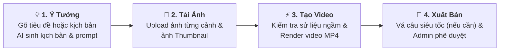

# 🎬 TÓM TẮT QUY TRÌNH TẠO VIDEO & AUDIO (CREATOR STUDIO)

> **Tài liệu tóm tắt nhanh luồng nghiệp vụ tạo Video/Audio dành cho Nhà Sáng Tạo Nội Dung (Creator).**

---

## ⚡ 1. Sơ Đồ 4 Bước Trực Quan

---

## 🖼️ 2. Phân Biệt Ảnh Bìa Podcast vs Ảnh Thumbnail

- **Ảnh Bìa Podcast (`coverImage`)**: Dành riêng cho chế độ **Audio Podcast**. Vì podcast không có hình vẽ hoạt họa, ảnh bìa này được Engine **chiếu trực tiếp làm nền trong video MP4** (kèm sóng âm nhảy và phụ đề chạy chữ).
- **Ảnh Thumbnail Video (`thumbnailUrl`)**: Là **tấm poster tĩnh ngoài trang chủ** (giống hệt Thumbnail trên YouTube). Xuất hiện trên thẻ bài viết để người xem click vào trước khi bấm nút Play. Áp dụng cho cả Video vẽ tay và Podcast.

---

## 🔄 3. Hành Trình Tạo Video Của Creator

### Bước 1: Chọn định dạng & Nhập ý tưởng -> Nhận Kịch bản & Prompt từ AI
1. **Chọn định dạng video (`renderMode`)**:
   - 🎙️ **Audio Podcast Video (`audio_podcast`)** *(Đề xuất)*: Chỉ cần 1 ảnh bìa, render cực nhanh (30s-60s), hỗ trợ vá kịch bản theo câu siêu tốc.
   - 🖌️ **Hoạt Họa Bảng Trắng (`whiteboard`)**: Video vẽ tay phác thảo từng cảnh, cần ảnh cho từng phân cảnh.
2. **Nhập nội dung (Chọn 1 trong 2 cách)**:
   - **🟢 Cách 1 - Chỉ nhập Tiêu đề ngắn (< 100 ký tự)**: Creator chưa có kịch bản. AI tự dùng RAG đọc sách sử gốc và Gemini tự sáng tác kịch bản từ A đến Z theo thời lượng.
   - **🔵 Cách 2 - Dán Kịch bản có sẵn ($\ge$ 100 ký tự)**: Creator đã có kịch bản tự viết. Hệ thống **tôn trọng 100% nguyên tác, tuyệt đối không viết lại hay sửa chữ**, chỉ chia nhỏ kịch bản gốc vào các cảnh.
3. **AI sinh sẵn bộ Prompt ảnh**:
   - Với Podcast: Sinh `thumbnail_prompt` để tạo **Ảnh Bìa Podcast**.
   - Với Bảng Trắng: Sinh `image_prompt` cho từng cảnh + `thumbnail_prompt` cho **Ảnh Thumbnail Poster 16:9**.

### Bước 2: Tạo ảnh bên ngoài & Tải ảnh lên hệ thống
- Creator copy prompt sang Midjourney / DALL-E / Canva tạo ảnh.
- Tải ảnh lên hệ thống (`POST /upload-image`):
  - Tải ảnh vào **Cảnh 1, Cảnh 2, Cảnh 3...** (bắt buộc với video vẽ tay).
  - Tải ảnh vào ô **"Ảnh Thumbnail đại diện (Tùy chọn)"** (Creator tự thêm ảnh poster riêng của mình).

### Bước 3: Bấm duy nhất nút "Tạo Video" (Hệ thống tự động xử lý ngầm)
- Creator bấm **"Bắt đầu kết xuất"** $\rightarrow$ Hệ thống tự động làm 2 việc ngầm:
  1. **Kiểm tra sử liệu ngầm (Rào chắn mềm)**: Nếu kịch bản chuẩn, tự động render ngay. Nếu có nghi vấn, hiện popup cảnh báo nhẹ để Creator chọn sửa hoặc bảo lưu quan điểm.
  2. **Kích hoạt render (`POST /render`)**: Gửi kèm `thumbnailUrl` (ảnh Thumbnail do Creator chọn). Backend lưu ngay vào Database và giao việc cho Python Render Engine chạy ngầm, trả về mã theo dõi `jobId`.
- Web hiển thị thanh tiến trình 6 bước (0% $\rightarrow$ 100%). Kể cả khi Creator tắt tab, video vẫn được máy chủ vẽ xong và lưu an toàn vào Thư viện.

### Bước 4: Xem trước, Vá lỗi siêu tốc & Xuất bản
- Video hoàn thành nằm trong Thư viện ở trạng thái `COMPLETED`.
- **Nếu cần sửa phát âm 1 vài câu**: Dùng tính năng **Vá kịch bản theo câu (Smart Script Patching)**. Python chỉ thu âm lại đúng 1 câu bị sửa và ghép lại video trong chưa đầy 10 giây. Bản video cũ ngoài trang chủ vẫn tiếp tục chiếu bình thường, không bị gián đoạn!
- **Gửi duyệt (`POST /submit-publish`)**: AI Shield chấm điểm an toàn $\rightarrow$ Admin bấm **DUYỆT** $\rightarrow$ Video chính thức công khai (`PUBLISHED`) ra trang chủ.

---

## 📡 4. Danh Mục API Endpoints Chính

| Hành động | Endpoint | Ghi chú |
|---|---|---|
| **Cấu hình AI Key** | `GET / PUT /api/v1/creator/studio/settings` | Lưu Gemini Key & ElevenLabs Key |
| **Nghe thử giọng** | `POST /api/v1/creator/studio/voices/preview` | Sinh audio nghe thử câu mẫu trực tiếp |
| **Sinh kịch bản & Prompt** | `POST /api/v1/creator/studio/storyboard` | Sinh kịch bản + Prompt từng cảnh + **Prompt Thumbnail** |
| **Tải ảnh cảnh / bìa / thumbnail** | `POST /api/v1/creator/studio/upload-image` | Upload lên Cloudinary, trả về link CDN |
| **Khởi chạy Render Video** | `POST /api/v1/creator/studio/render` | Nhận `thumbnailUrl`, `sceneImages`, lưu DB và render ngầm |
| **Thăm dò tiến độ** | `GET /api/v1/creator/studio/jobs/{jobId}` | Polling mỗi 2s cập nhật thanh tiến trình 6 bước |
| **Tải file Thumbnail riêng** | `POST /api/v1/creator/studio/videos/{id}/thumbnail` | Upload tệp ảnh thumbnail tùy chỉnh trực tiếp |
| **Sửa video & Thumbnail** | `PUT /api/v1/creator/studio/videos/{id}` | Cập nhật tiêu đề, mô tả, đường dẫn `thumbnailUrl` |
| **Lấy câu kịch bản podcast** | `GET /api/v1/creator/studio/videos/{id}/podcast-sentences` | Lấy danh sách câu và link audio nghe thử từng câu |
| **Vá kịch bản podcast** | `POST /api/v1/creator/studio/videos/{id}/patch-podcast` | Thu âm lại câu sửa & đổi ảnh bìa và ghép nhanh lại video |
| **Gửi duyệt xuất bản** | `POST /api/v1/creator/studio/videos/{id}/submit-publish` | Chạy AI Shield + tạo phiếu cho Admin duyệt |

---
*Tài liệu nội bộ hệ thống PRM History Podcast.*
