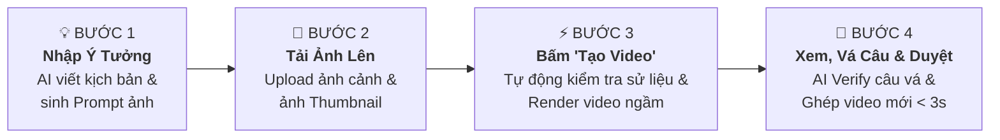
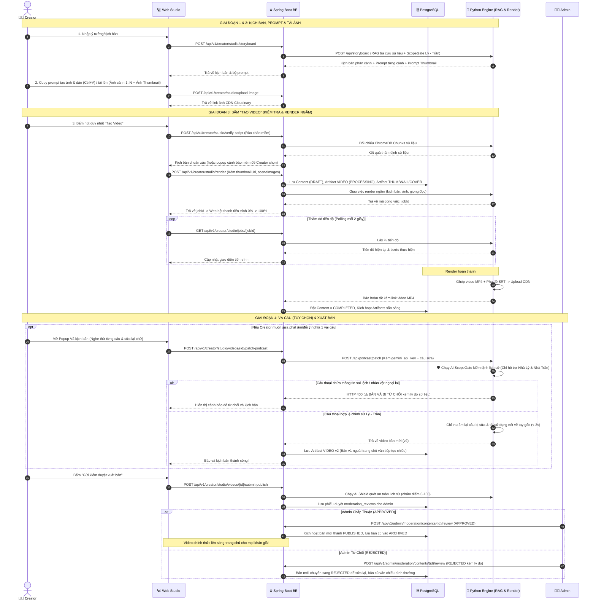

# 🎬 HƯỚNG DẪN TOÀN DIỆN: QUY TRÌNH TẠO VIDEO LỊCH SỬ DÀNH CHO CREATOR

> **Phiên bản:** 3.2 (Bổ sung Gatekeeper Thẩm định thực thể Lý - Trần, Dán ảnh Clipboard siêu tốc & Fallback TTS đa tầng)  
> **Áp dụng cho:** Nền tảng Kể chuyện & Podcast Lịch sử Việt Nam (PRM History Podcast).

---

## 📌 MỤC LỤC
1. [Bức Tranh Tổng Quan: Hành Trình 4 Giai Đoạn](#1-bức-tranh-tổng-quan-hành-trình-4-giai-đoạn)
2. [Phân Biệt 2 Khái Niệm Quan Trọng Dễ Nhầm Lẫn](#2-phân-biệt-2-khái-niệm-quan-trọng-dễ-nhầm-lẫn)
   - [So sánh Video Vẽ Tay (Whiteboard) vs Audio Podcast](#a-video-vẽ-tay-whiteboard-vs-video-audio-podcast)
   - [So sánh Ảnh Bìa Podcast (Cover) vs Ảnh Thumbnail Video](#b-ảnh-bìa-podcast-coverimage-vs-ảnh-thumbnail-video-thumbnailurl)
3. [Chi Tiết 4 Giai Đoạn Từ Ý Tưởng Đến Khi Xuất Bản](#3-chi-tiết-4-giai-đoạn-từ-ý-tưởng-đến-khi-xuất-bản)
   - [Giai đoạn 1: Nhập ý tưởng -> Bộ Gác Cổng Sử Liệu (ScopeGate) & AI viết kịch bản](#giai-đoạn-1-nhập-ý-tưởng---bộ-gác-cổng-sử-liệu-scopegate--ai-viết-kịch-bản)
   - [Giai đoạn 2: Tạo ảnh bên ngoài & Dán trực tiếp từ Clipboard / Upload lên hệ thống](#giai-đoạn-2-tạo-ảnh-bên-ngoài--dán-trực-tiếp-từ-clipboard--upload-lên-hệ-thống)
   - [Giai đoạn 3: Bấm duy nhất nút "Tạo Video" (Fallback TTS & Render ngầm)](#giai-đoạn-3-bấm-duy-nhất-nút-tạo-video-fallback-tts--render-ngầm)
   - [Giai đoạn 4: Xem trước, Vá kịch bản (AI Verify chống lách luật & Render siêu tốc) & Gửi Admin duyệt](#giai-đoạn-4-xem-trước-vá-kịch-bản-ai-verify-chống-lách-luật--render-siêu-tốc--gửi-admin-duyệt)
4. [Sơ Đồ Kỹ Thuật Tuần Tự (Sequence Diagram)](#4-sơ-đồ-kỹ-thuật-tuần-tự-sequence-diagram)
5. [Danh Mục 16 API Endpoints Dành Cho Lập Trình Viên](#5-danh-mục-16-api-endpoints-dành-cho-lập-trình-viên)

---

## 1. Bức Tranh Tổng Quan: Hành Trình 4 Giai Đoạn

Quy trình tạo video được thiết kế để Creator **chỉ cần tập trung vào sáng tạo nội dung**, toàn bộ phần việc kỹ thuật nặng nhọc (tra cứu sử liệu, tính toán thời lượng, vẽ nét tay hoạt họa, ghép phụ đề, nén video) đều do AI và hệ thống tự động xử lý:



---

## 2. Phân Biệt 2 Khái Niệm Quan Trọng Dễ Nhầm Lẫn

### A. Video Vẽ Tay (`whiteboard`) vs Video Audio Podcast (`audio_podcast`)

| Tiêu chí | 🖌️ Video Bảng Trắng Vẽ Tay (`whiteboard`) | 🎙️ Video Audio Podcast (`audio_podcast`) |
|---|---|---|
| **Hình thức hiển thị** | Từng nét vẽ phác thảo tay xuất hiện dần theo giọng đọc trên nền giấy cổ (giống phong cách vẽ hoạt họa). | Ảnh bìa tĩnh đặt ở trung tâm, xung quanh là hiệu ứng sóng âm động nhảy theo giọng đọc podcast. |
| **Yêu cầu hình ảnh** | **Bắt buộc phải có ảnh cho từng cảnh** (Cảnh 1, Cảnh 2, Cảnh 3...). | **Chỉ cần duy nhất 1 ảnh bìa** (`coverImage`) làm nền trung tâm. |
| **Độ dài & Định dạng** | Tỷ lệ ngang **16:9** (1920x1080), thời lượng 30s – 180s. | Tỷ lệ **1:1** hoặc **16:9**, thời lượng linh hoạt (1 – 15 phút). |
| **Thời gian render** | 2 – 5 phút (do máy tính phải bóc tách vector vẽ từng khung hình). | 30 – 60 giây (ghép nhanh âm thanh và hình nền). |

---

### B. Ảnh Bìa Podcast (`coverImage`) vs Ảnh Thumbnail Video (`thumbnailUrl`)

Hai loại ảnh này phục vụ mục đích khác nhau:

```
+------------------------------------------------------------------------------------+
| TRANG CHỦ / FEED KHÁM PHÁ (YouTube / Web / App):                                   |
|                                                                                    |
|  [ THUMBNAIL / POSTER ]  --> Tấm ảnh tĩnh 16:9 thu hút người xem click vào         |
|  "ĐẠI THẮNG BẠCH ĐẰNG"       (Được lưu ở trường thumbnailUrl, áp dụng cho cả 2 loại) |
+------------------------------------------------------------------------------------+
         │
         ▼ (Người xem bấm nút Play ▶️)
+------------------------------------------------------------------------------------+
| NỘI DUNG PHÁT BÊN TRONG VIDEO:                                                     |
|                                                                                    |
|  * Nếu là Video Vẽ Tay:   Màn hình vẽ tranh Cảnh 1 -> Cảnh 2 -> Cảnh 3...          |
|  * Nếu là Audio Podcast:  Màn hình hiển thị [ ẢNH BÌA PODCAST - coverImage ]       |
|                           kèm sóng âm nhảy múa và phụ đề chạy chữ bên dưới.        |
+------------------------------------------------------------------------------------+
```

- **Ảnh Bìa Podcast (`coverImage`)**: Là **nội dung nhìn thấy bên trong video Podcast**. Vì podcast không có các cảnh vẽ hoạt họa, hệ thống lấy ảnh bìa này đặt làm tâm điểm hiển thị của toàn bộ video MP4.
- **Ảnh Thumbnail (`thumbnailUrl`)**: Là **tấm biển quảng cáo ngoài rạp (Poster)**. Nó xuất hiện trên thẻ video ở Trang chủ / Tìm kiếm / Danh sách phát để người xem nhìn thấy trước khi bấm nút Play. Áp dụng cho cả Video vẽ tay lẫn Video podcast.

---

## 3. Chi Tiết 4 Giai Đoạn Từ Ý Tưởng Đến Khi Xuất Bản

### Giai đoạn 1: Chọn định dạng, Nhập ý tưởng -> Bộ Gác Cổng Sử Liệu (ScopeGate) & AI viết kịch bản

#### 1. Creator làm gì?
Khi mở Creator Studio, Creator thực hiện 3 thao tác đầu tiên:

##### 🔘 Thao tác 1: Chọn Định dạng video muốn tạo (`renderMode`)
Creator bấm chọn 1 trong 2 định dạng hiển thị ngay đầu trang:
- 🎙️ **Lựa chọn 1 - Audio Podcast Video (`audio_podcast`)**:
  - *Đặc điểm*: Dành cho nội dung podcast kể chuyện, bình luận lịch sử, tâm sự truyền cảm.
  - *Ưu điểm*: **Cực nhanh và tiện lợi**: Chỉ cần **duy nhất 1 ảnh bìa** (`coverImage`), không cần vẽ ảnh từng cảnh. Thời gian render chỉ 30 – 60 giây. Sau này hỗ trợ tính năng **Vá kịch bản theo câu siêu tốc (Smart Patching)**.
- 🖌️ **Lựa chọn 2 - Hoạt Họa Bảng Trắng (`whiteboard`)**:
  - *Đặc điểm*: Dành cho video tái hiện diễn biến trận đánh, giai thoại lịch sử có hình ảnh trực quan sinh động.
  - *Yêu cầu*: Cần có ảnh minh họa cho **từng phân cảnh** (Cảnh 1, Cảnh 2...) để máy tính bóc tách nét vẽ tay dòng mực dần xuất hiện trên nền giấy cổ. Thời gian render: 2 – 5 phút.

##### 🔘 Thao tác 2: Nhập nội dung (Chọn 1 trong 2 cách)
Sau khi chọn định dạng, Creator nhập nội dung vào ô văn bản:

| Cách nhập | Ví dụ đầu vào | Ý nghĩa thực tế |
|---|---|---|
| **🟢 Cách 1: Chỉ nhập Tiêu đề ngắn** (< 100 ký tự) | *"Trận Như Nguyệt 1077"* hoặc *"Hào khí Đông A"* | Creator **chưa có kịch bản**, muốn AI tự động nghiên cứu sử liệu và viết trọn vẹn kịch bản từ A đến Z. |
| **🔵 Cách 2: Dán Kịch bản có sẵn** (Đoạn văn dài $\ge$ 100 ký tự) | Đoạn văn bản kịch bản hoàn chỉnh do Creator tự chuẩn bị | Creator **đã có kịch bản của riêng mình**, chỉ muốn hệ thống chia cảnh, đọc lồng tiếng và dựng video chứ **tuyệt đối không được sửa đổi câu chữ**. |

##### 🔘 Thao tác 3: Chọn Giọng đọc AI & Thời lượng
- Chọn giọng đọc AI yêu thích (NamMinh, HoaiMy,...) từ danh mục giọng đọc tiếng Việt.
- Chọn thời lượng mong muốn (30s, 60s, 90s, 180s...).
- Bấm nút **"Tạo Phân Cảnh & Kịch Bản"** (`POST /storyboard`).

---

#### 2. Bộ Gác Cổng Sử Liệu (ScopeGate) & Thẩm Định Thực Thể (Strict Entity Audit)
Ngay khi bấm tạo kịch bản, hệ thống **không vội gửi ngay cho AI sinh chữ**, mà kích hoạt lớp bảo vệ chính sử:

1. **Phạm vi sử liệu chuyên biệt**:
   Hệ thống được thiết kế chuyên sâu cho các sự kiện, danh nhân và tư liệu thuộc:
   - **Triều đại Nhà Lý (1009 – 1225)**: *Lý Thái Tổ, Chiếu dời đô 1010, Lý Thường Kiệt, phòng tuyến sông Như Nguyệt 1077...*
   - **Triều đại Nhà Trần (1225 – 1400)**: *Trần Hưng Đạo, 3 lần kháng chiến chống quân Nguyên Mông (1258, 1285, 1288), Hịch tướng sĩ, Hội nghị Diên Hồng, đại thắng Bạch Đằng 1288...*
2. **Quy tắc kiểm định thực thể từng câu chữ (Strict Entity Audit)**:
   - **Cấm nhân vật ngoại lai**: Chặn đứng việc chèn nhân vật ngoài lịch sử Việt Nam (như thời Tam Quốc: *Trương Liêu, Lưu Bị, Tào Tháo, Quan Vũ, Gia Cát Lượng...*, kiếm hiệp, tiểu thuyết hư cấu).
   - **Cấm xáo trộn triều đại**: Chặn đứng việc đưa nhân vật thời kỳ khác (*Đinh Bộ Lĩnh, Ngô Quyền, Lê Lợi, Quang Trung...*) vào bối cảnh thời Lý - Trần.
   - **Cấm râu ông nọ cắm cằm bà kia**: Chặn đứng các mâu thuẫn thời gian nghiêm trọng (như gộp Lý Thường Kiệt thời Lý tham gia trận Bạch Đằng 1288 thời Trần, hoặc gán Lý Thái Tổ đánh giặc Mông Nguyên).
   - **Quy tắc tuyệt đối**: Dù bài viết có **99% nội dung đúng về nhà Trần**, nhưng nếu có **bất kỳ một nhân vật ngoại lai/sai thời kỳ** bị chèn vào, Gatekeeper lập tức **TỪ CHỐI NGAY LẬP TỨC** (`in_scope = false`).
3. **Giao diện phản hồi chuẩn `/ui-ux-pro-max` & `/taste`**:
   - Khi bị từ chối, hệ thống mở **Modal Kiểm Định Sử Liệu Đại Việt** (`#modalTopicRejected`) với đầy đủ:
     - 📜 Trích yếu kịch bản người dùng đã nhập.
     - ⚠️ Chỉ rõ đích danh nhân vật hoặc chi tiết sai phạm (kèm lý do lịch sử).
     - 💡 Cung cấp 2 mẫu kịch bản chuẩn sử 1-click: *Lý Thường Kiệt & Phòng Tuyến Như Nguyệt (1077)* và *Trần Hưng Đạo & Chiến Thắng Bạch Đằng (1288)*.
     - ✏️ Nút bấm quay lại tự động cuộn và focus vào ô kịch bản để sửa lại tức thì.

---

#### 3. AI & Hệ thống xử lý kịch bản sau khi đã qua cửa Gác Cổng

- **Nếu Creator chọn Cách 1 (Chỉ nhập Tiêu đề ngắn)**:
  1. **AI đóng vai Biên kịch lịch sử**: Dùng công nghệ **RAG** truy vấn kho tài liệu sử gốc (*Đại Việt Sử Ký Toàn Thư*, *Khâm Định Việt Sử Thông Giám Cương Mục*) để lấy chính xác mốc năm, nhân vật và sự kiện có thật.
  2. **Tự động viết kịch bản mới 100%**: Gemini AI sáng tác kịch bản hoàn chỉnh, đĩnh đạc theo phong cách phim tài liệu, khớp đúng thời lượng đã chọn.
  3. **Tự động phân bổ cấu trúc**:
     - *Với Audio Podcast*: Tạo bài thuyết minh liền mạch theo mạch cảm xúc.
     - *Với Video Bảng Trắng*: Chia kịch bản thành các phân cảnh hợp lý (ví dụ: video 60s chia thành 2 cảnh, mỗi cảnh ~30s).
  4. **Tự động sinh Prompt ảnh**: Sinh prompt ảnh phù hợp với định dạng đã chọn.

- **Nếu Creator chọn Cách 2 (Dán Kịch bản có sẵn)**:
  1. **TÔN TRỌNG NGUYÊN TÁC 100%**: Hệ thống **TUYỆT ĐỐI KHÔNG dùng AI viết lại, không tự ý sửa đổi hay bịa thêm nội dung** vào câu chữ của Creator.
  2. **Chỉ làm nhiệm vụ biên tập & chia thời lượng**: Cắt đoạn văn bản gốc của Creator thành các câu/cảnh vừa vặn với thời lượng (để khi chuyển thành giọng đọc AI thì tốc độ đọc tự nhiên, không bị quá vội hoặc quá chậm).
  3. **Tự động sinh Prompt ảnh**: Đọc hiểu nội dung từng đoạn của Creator để gợi ý prompt vẽ tranh minh họa tương ứng (chuẩn 1 hàng ngang doodle duy nhất).

#### 4. Bộ Prompt ảnh AI trả về theo định dạng video:
- **Nếu chọn Audio Podcast (`audio_podcast`)**: AI trả về `thumbnail_prompt` — prompt tạo **Ảnh Bìa Podcast** nghệ thuật (tỷ lệ 1:1 hoặc 16:9). Creator chỉ cần tạo duy nhất 1 bức ảnh này.
- **Nếu chọn Video Bảng Trắng (`whiteboard`)**: AI trả về đầy đủ:
  - `image_prompt`: Prompt vẽ tranh phác thảo doodle 16:9 cho từng cảnh (Cảnh 1, Cảnh 2, Cảnh 3...).
  - `thumbnail_prompt`: Prompt tạo **Ảnh Thumbnail Poster** 16:9 điện ảnh hoành tráng để làm ảnh bìa ngoài trang chủ.

#### 5. Màn hình hiển thị gì?
- Kịch bản chi tiết hiển thị trực quan để Creator tự do đọc duyệt và chỉnh sửa từng từ ngữ theo ý muốn.
- Có sẵn nút **"Copy Prompt"** tiện lợi để Creator sao chép mang sang Midjourney / DALL-E tạo ảnh.

---

### Giai đoạn 2: Tạo ảnh bên ngoài & Dán trực tiếp từ Clipboard / Tải ảnh lên hệ thống

1. **Creator làm gì?**
   - Creator bấm nút copy prompt từ Bước 1 sang các công cụ AI tạo ảnh (Midjourney, DALL-E 3, Bing Image Creator, Leonardo AI, Canva,...).
   - **Tải ảnh lên siêu tốc với 2 cơ chế linh hoạt**:
     - **🟢 Cơ chế 1: Dán trực tiếp từ Clipboard (`Ctrl + V` / `Cmd + V`) - Khuyên dùng**:
       + Sau khi sinh ảnh trên web AI hoặc copy ảnh bất kỳ, Creator chỉ cần bấm nút `[📋 Dán ảnh]` hoặc `[📋 Dán đè]` ngay trên từng ô phân cảnh, hoặc click chọn ô phân cảnh rồi nhấn phím tắt `Ctrl + V` (Windows) / `Cmd + V` (Mac).
       + Hệ thống tự động đọc dữ liệu nhị phân từ Clipboard và tải trực tiếp lên Cloudinary CDN mà Creator **không cần phải tốn công tải file về máy tính rồi mở hộp thoại duyệt tệp**.
     - **📁 Cơ chế 2: Tải tệp từ máy tính truyền thống**:
       + Bấm nút `[📁 Chọn tệp]` để duyệt ảnh từ thư mục máy tính như thông thường.
   - **Phân bổ ảnh theo định dạng video**:
     - **Với Video Vẽ Tay (`whiteboard`)**: Dán/Tải ảnh vào các ô **Cảnh 1, Cảnh 2, Cảnh 3...** (bắt buộc). Đồng thời có thêm ô **"Ảnh Thumbnail đại diện (Tùy chọn)"** để dán tấm poster đẹp nhất làm ảnh bìa video.
     - **Với Video Audio Podcast (`audio_podcast`)**: Dán/Tải 1 ảnh duy nhất vào ô **"Ảnh Bìa Podcast"**.
   - **Giao diện quản lý ảnh thông minh**:
     - Mỗi ô phân cảnh hỗ trợ xem trước ảnh rõ nét, kèm 2 nút thao tác nhanh: `[Đổi ảnh]` (hoặc `[📋 Dán đè]`) và `[Xóa]` để Creator thoải mái tinh chỉnh.

2. **Hệ thống làm gì?**
   - Khi nhận tệp ảnh tải lên hoặc blob dán từ Clipboard, hệ thống tự động gọi API `POST /upload-image` gửi ảnh lên Cloudinary CDN và nhận về URL an toàn (`https://res.cloudinary.com/...`).
   - Link ảnh từng cảnh và link Thumbnail được gán tự động vào phân cảnh tương ứng và lưu trữ sẵn sàng chuẩn bị cho Bước 3.

---

### Giai đoạn 3: Bấm duy nhất nút "Tạo Video" (Multi-Tier Fallback TTS & Render ngầm)

1. **Creator làm gì?**
   - Creator kiểm tra lại lần cuối và bấm **duy nhất 1 nút "Bắt Đầu Tạo Video"**.
2. **Hệ thống tự động thực thi 2 nhịp ngầm phía sau:**
   - **Nhịp 1 - Rào chắn mềm kiểm tra sử liệu (`POST /verify-script`)**:
     - Màn hình tạm hiển thị: *"🔍 Đang đối chiếu sử liệu..."* trong 1-2 giây.
     - Hệ thống đối chiếu kịch bản với kho chunks dữ liệu sử liệu.
     - **Nếu kịch bản chuẩn xác**: Hệ thống **tự động chạy thẳng sang Nhịp 2** trong tích tắc mà không làm phiền người dùng.
     - **Nếu kịch bản có nghi vấn sử liệu**: Hệ thống bật một popup cảnh báo mềm chuẩn `/ui-ux-pro-max`, trích dẫn rõ sách sử nói gì và đề xuất câu sửa. Creator có 2 lựa chọn:
       + Bấm *"Áp dụng câu sửa của AI"* $\rightarrow$ Kịch bản cập nhật chuẩn ngay.
       + Bấm *"Bảo lưu quan điểm, Vẫn tạo video"* $\rightarrow$ Hệ thống hoàn toàn tôn trọng ý kiến Creator và tiếp tục sản xuất.
   - **Nhịp 2 - Kích hoạt sản xuất video (`POST /render`)**:
     - Web gửi toàn bộ thông tin sang Backend: tiêu đề, kịch bản, ảnh các cảnh, giọng đọc, và **trường `thumbnailUrl` (ảnh thumbnail mà Creator đã tải hoặc dán ở Giai đoạn 2)**.
     - **Backend lưu ngay hồ sơ vào Database (~0.05 giây)**:
       + Lưu Video ở trạng thái `DRAFT` (Bản nháp).
       + Lưu tệp video trạng thái `PROCESSING` (Đang render) với `version = 1`.
       + Lưu ảnh Thumbnail do Creator gửi lên vào bảng `artifacts` (`type = 'THUMBNAIL'`). *(Nếu lúc này Creator chưa kịp tải ảnh thumbnail riêng, hệ thống tự động lấy tạm ảnh Cảnh 1 làm dự phòng để video không bao giờ bị rỗng ảnh bìa ngoài trang chủ).*
     - **Giao việc cho Python Engine chạy ngầm**: Backend chuyển giao việc cho Python Render Engine, nhận về một mã vé gọi là **`jobId`** (ví dụ: `job_8f29d10a`).
3. **Màn hình hiển thị gì?**
   - Web nhận được `jobId` liền bật ngay **Thanh tiến trình (Progress Bar)** hiển thị 6 bước trực quan:
     1. Khởi tạo tác vụ & nạp dữ liệu phân cảnh.
     2. Tải ảnh phân cảnh từ CDN về máy chủ render.
     3. **Thu âm lồng tiếng AI TTS với Cơ chế Fallback đa tầng (Multi-tier TTS Resilience)**:
        - *Tầng 1 (Chính)*: Sử dụng Microsoft Edge-TTS (`vi-VN-NamMinhNeural` / `vi-VN-HoaiMyNeural`) mang lại giọng đọc truyền cảm, hào hùng và tự nhiên.
        - *Tầng 2 (Dự phòng tự động)*: Nếu Edge-TTS gặp sự cố kết nối, quá tải hoặc phản hồi `NoAudioReceived`, hệ thống **lập tức chuyển đổi trong suốt sang Google Translate TTS Engine (`client=tw-ob`)** để đọc tiếp câu thoại. Video không bao giờ bị gián đoạn hay báo lỗi render giữa chừng.
     4. Tạo phụ đề SRT đồng bộ chính xác từng phần trăm giây theo thời lượng âm thanh thực tế.
     5. Biên dịch khung hình nét vẽ tay / Ghép hiệu ứng video MP4.
     6. Đẩy video thành phẩm lên Cloudinary CDN $\rightarrow$ Hoàn tất 100%!

> [!TIP]
> **Không sợ mất dữ liệu:** Quá trình render chạy hoàn toàn ngầm trên máy chủ. Kể cả Creator có tắt trình duyệt hay mất mạng, video vẫn được máy chủ vẽ xong và lưu an toàn vào Thư viện của Creator.

---

### Giai đoạn 4: Xem trước, Vá kịch bản (AI Verify Chống Lách Luật & Ghép Video Siêu Tốc) & Gửi Admin duyệt

1. **Xem trước trong Thư viện:**
   - Video sau khi hoàn thành có trạng thái `COMPLETED` (nằm an toàn trong Thư viện cá nhân của Creator, chưa ai bên ngoài nhìn thấy).
   - Creator mở video xem lại hình ảnh, nghe giọng đọc và xem phụ đề.
   - Nếu muốn đổi ảnh Thumbnail khác: Creator bấm nút "Đổi Thumbnail" (`POST /videos/{id}/thumbnail` hoặc `PUT /videos/{id}`) để thay ảnh bìa mới bất cứ lúc nào.
2. **Vá kịch bản siêu tốc theo từng câu (Smart Script Patching) - Tùy chọn:**
   - Nếu nghe lại thấy 1 từ phát âm chưa chuẩn (ví dụ chữ *"Bạch Đằng"* đọc chưa vang), cần bổ sung chi tiết hoặc chỉnh sửa câu chữ:
   - **Không cần tạm ẩn video**: Nếu video đang phát sóng công khai ngoài trang chủ (`PUBLISHED`), bản `v1` cũ vẫn tiếp tục chiếu cho khán giả xem bình thường, không bị gián đoạn hay mất lượt xem!
   - **Popup Vá kịch bản trực quan**: Hệ thống bóc tách toàn bộ câu thoại và liên kết nút **"Nghe thử"** riêng biệt cho từng câu (`GET /podcast-sentences`), hỗ trợ chuẩn xác cả video vẽ tay Whiteboard (`scene_{s}_elem_{e}.mp3`) lẫn Audio Podcast (`clip_{idx}.mp3`).

   > [!IMPORTANT]
   > **🛡️ TẠI SAO BẮT BUỘC PHẢI CÓ THẨM ĐỊNH AI VERIFY Ở BƯỚC VÁ VIDEO? (CƠ CHẾ CHỐNG LÁCH LUẬT - ANTI-BYPASS SECURITY):**
   > - **Nguy cơ tiềm ẩn**: Nếu không có bước kiểm duyệt AI tại nút *"Bắt Đầu Vá Video"*, người dùng hoặc Creator có thể tận dụng kẽ hở: ban đầu nhập một kịch bản chuẩn sử liệu để vượt qua bộ gác cổng AI ScopeGate ở đợt 1, sau khi video render xong thì quay lại popup Vá Video để sửa đổi, chèn thêm thông tin sai lệch lịch sử hoặc nhân vật ngoại lai.
   > - **Mặc dù hệ thống có lớp kiểm duyệt AI Shield** ở bước nộp duyệt cuối cùng trước khi chuyển Admin, nhưng việc để xuất hiện một video bị sai lệch sử liệu nằm sẵn trong hệ thống vẫn là rủi ro rất lớn.
   > - **Giải pháp chốt chặn kép**: Ngay khi Creator bấm nút **"Bắt Đầu Vá Video"** (`POST /api/podcast/patch`), hệ thống **bắt buộc chạy lại toàn bộ thuật toán AI ScopeGate (Strict Entity & Chronology Audit)** kiểm tra tính đúng đắn của toàn bộ câu thoại mới.
   > - **Quy tắc kiểm định**: Toàn bộ nội dung câu vá phải thuần khiết thuộc thời kỳ **Nhà Lý (1009 – 1225)** và **Nhà Trần (1225 – 1400)**.
   > - **Chặn đứng mọi ý đồ gian lận**: Nếu phát hiện nhân vật hư cấu, nhân vật ngoại lai (như *Trương Liêu, Lưu Bị, Quan Vũ, Tào Tháo...* thời Tam Quốc, hoặc nhân vật triều đại khác như *Đinh Bộ Lĩnh, Lê Lợi...*) hoặc gán ghép sai niên đại (như *Lý Thường Kiệt* tham gia trận Bạch Đằng 1288), hệ thống sẽ **từ chối bản vá ngay lập tức (`HTTP 400`)** với thông điệp:
   >   ```text
   >   ⚠️ BẢN VÁ BỊ TỪ CHỐI (CHỈ HỖ TRỢ THỜI KỲ LÝ - TRẦN):
   >   Nội dung chỉnh sửa: "<câu thoại vi phạm>"
   >   Lý do: <chi tiết sai phạm cụ thể do AI phát hiện>
   >   ```
   >   Toàn bộ tiến trình thu âm và ghép video bị hủy bỏ tức thì, toast thông báo lỗi đỏ hiện lên trên giao diện để bảo vệ 100% tính nguyên vẹn của lịch sử!

   - **⚡ Cơ chế Vá siêu tốc theo từng định dạng video (< 3 giây)**:
     - **Với Video vẽ tay (Whiteboard)**: Nhận diện chính xác câu sửa thuộc phân cảnh (scene) và phần tử (element) nào. **Chỉ thu âm lại đúng câu đó**, giữ nguyên và tái sử dụng 100% video hoạt họa nét vẽ tay gốc (`scene_*_raw.mp4`), tính toán lại nhịp nói, dập lại phụ đề Hardsub và ghép nối các cảnh hoàn tất trong chưa đầy **3 giây** (tiết kiệm 95% thời gian và hoàn toàn không phải vẽ lại tay từ đầu).
     - **Với Video Audio Podcast**: Thu âm lại câu sửa, cập nhật lại ảnh bìa nếu Creator dán/tải ảnh mới và ghép lại video podcast trong < 5 giây.
   - Hệ thống tạo ra một phiên bản mới `v2` độc lập với trạng thái `COMPLETED` để Creator xem trước.

   > [!IMPORTANT]
   > **🔒 PHÂN QUYỀN DUYỆT CÔNG KHAI (ADMIN-ONLY PUBLISH & PHIÊN BẢN v1/v2):**
   > - **Creator KHÔNG THỂ tự ý công khai video**: Nút "Công Khai" trực tiếp bị loại bỏ hoàn toàn đối với vai trò Creator. Mọi tác phẩm mới (kể cả bản vá `v2`) sau khi render xong đều ở trạng thái `COMPLETED (Chưa Gửi Duyệt)`.
   > - **Quy trình bắt buộc**: Creator phải bấm **"Gửi Duyệt"** (hoặc **"Gửi Duyệt v2"**) $\rightarrow$ Hệ thống quét AI Shield $\rightarrow$ Đưa vào hàng đợi `PENDING_REVIEW` cho Admin.
   > - **Chỉ Quản trị viên (Admin) mới có quyền duyệt (`APPROVED`) để chuyển sang `PUBLISHED`**: Khi Admin phê duyệt, video mới chính thức xuất hiện trên ứng dụng người dùng.
   > - **Quản lý hiển thị (Ẩn / Hiện lại)**: Creator chỉ có quyền tạm ẩn (`Ẩn Video` $\rightarrow$ `HIDDEN`) hoặc bỏ ẩn (`Hiện Lại Video` $\rightarrow$ `PUBLISHED`) đối với các video **đã từng được Admin phê duyệt**. Nếu video chưa được Admin duyệt mà cố tình gọi API mở công khai, hệ thống sẽ chặn đứng và trả về lỗi `403 FORBIDDEN_ACCESS`.
   > - **Hiển thị huy hiệu & Bộ chọn phiên bản (Version Switcher & History)**:
   >   - Video `v1` **hoàn toàn không bị mất hay ghi đè**, mà luôn được lưu trữ nguyên vẹn trong cơ sở dữ liệu (`ARCHIVED`).
   >   - Trên mỗi thẻ video ở Studio, Creator có thể bấm các nút chọn nhanh `[v1 (Bản gốc)]` và `[v2 (Bản vá)]` để chuyển đổi khung phát video trên Player, so sánh âm thanh/hình ảnh và lấy link CDN riêng biệt của từng bản.
   >   - Nút hành động **[Lịch Sử]** mở bảng danh mục tất cả phiên bản theo thời gian, hỗ trợ tải về hoặc **Khôi phục bản cũ (Rollback)** làm bản chính của bài đăng bất kỳ lúc nào.

3. **Gửi kiểm duyệt xuất bản (`POST /submit-publish`):**
   - Khi Creator đã ưng ý với tác phẩm, bấm **"Gửi Kiểm Duyệt Xuất Bản"**.
   - **Lớp 1 - AI Shield tự động**: Quét video và kịch bản, chấm điểm an toàn nội dung lịch sử (0 – 100 điểm) và xếp hạng mức độ an toàn.
   - **Lớp 2 - Admin Phê Duyệt**:
     - Admin mở phiếu duyệt trong trang Quản trị kèm theo kết quả chấm điểm của AI Shield.
     - **Admin bấm DUYỆT (`APPROVED`)**: Video (hoặc bản vá `v2`) chính thức chuyển sang trạng thái `PUBLISHED` và phát sóng ra trang chủ. Bản `v1` cũ tự động lưu vào kho lưu trữ (`ARCHIVED`). Người xem luôn được thưởng thức phiên bản hoàn hảo nhất!
     - **Admin bấm TỪ CHỐI (`REJECTED`)**: Hệ thống ghi rõ lý do để Creator chỉnh sửa lại. Bản cũ đang phát sóng vẫn hoạt động bình thường, không bị gián đoạn.

---

## 4. Sơ Đồ Kỹ Thuật Tuần Tự (Sequence Diagram)



---

## 5. Danh Mục 16 API Endpoints Dành Cho Lập Trình Viên

| STT | Phương thức | Đường dẫn API | Chức năng nghiệp vụ |
|:---:|:---:|---|---|
| **1** | `GET` | `/api/v1/creator/studio/settings` | Xem cấu hình API Key (Gemini, ElevenLabs) và giọng đọc mặc định. |
| **2** | `PUT` | `/api/v1/creator/studio/settings` | Cập nhật cấu hình API Key cá nhân của Creator. |
| **3** | `POST` | `/api/v1/creator/studio/voices/preview` | Tạo file âm thanh nghe thử giọng đọc AI trực tiếp trên web. |
| **4** | `POST` | `/api/v1/creator/studio/storyboard` | Tích hợp **Bộ Gác Cổng Sử Liệu (ScopeGate) & Thẩm Định Thực Thể (Strict Entity Audit)** (chỉ hỗ trợ Nhà Lý 1009–1225 & Nhà Trần 1225–1400, chặn nhân vật ngoại lai/lệch thời kỳ), sinh phân cảnh kịch bản, **gợi ý prompt vẽ từng cảnh và prompt ảnh Thumbnail**. |
| **5** | `POST` | `/api/v1/creator/studio/verify-script` | Kiểm tra độ chuẩn xác sử liệu với kho chunks ChromaDB (Rào chắn mềm). |
| **6** | `POST` | `/api/v1/creator/studio/upload-image` | Tải tệp ảnh minh họa phân cảnh / ảnh bìa / thumbnail lên Cloudinary CDN (hỗ trợ cả **chọn file từ máy tính** lẫn **Dán trực tiếp từ Clipboard `Ctrl + V`**). |
| **7** | `POST` | `/api/v1/creator/studio/render` | Bắt đầu sản xuất video với **Cơ chế Fallback TTS Đa Tầng (Edge-TTS + Google Translate TTS)** chống rớt mạng: Lưu DB (DRAFT) + Giao việc ngầm cho Python (nhận `thumbnailUrl`, `coverImage`). |
| **8** | `GET` | `/api/v1/creator/studio/jobs/{jobId}` | Thăm dò tiến độ render video (Web gọi tự động mỗi 2 giây). |
| **9** | `GET` | `/api/v1/creator/studio/videos` | Lấy danh sách toàn bộ video kèm ảnh `thumbnailUrl` trong Thư viện của Creator. |
| **10** | `GET` | `/api/v1/creator/studio/videos/{contentId}` | Xem thông tin chi tiết video, số lượt xem/thích và ảnh `thumbnailUrl`. |
| **11** | `PUT` | `/api/v1/creator/studio/videos/{contentId}` | Sửa tiêu đề, mô tả, hoặc **cập nhật lại đường dẫn ảnh `thumbnailUrl`**. |
| **12** | `POST` | `/api/v1/creator/studio/videos/{contentId}/thumbnail` | **Creator tải trực tiếp file ảnh Thumbnail từ máy tính lên Cloudinary** để gán cho video. |
| **13** | `PATCH` | `/api/v1/creator/studio/videos/{contentId}/visibility` | Ẩn hoặc Hiện video đã xuất bản (`PUBLISHED` $\leftrightarrow$ `HIDDEN`). |
| **14** | `GET` | `/api/v1/creator/studio/videos/{contentId}/podcast-sentences` | Lấy danh sách từng câu thoại kèm file audio riêng lẻ (`scene_{s}_elem_{e}.mp3` hoặc `clip_{idx}.mp3`) để nghe thử trước khi vá câu (hỗ trợ cả Whiteboard và Podcast). |
| **15** | `POST` | `/api/v1/creator/studio/videos/{contentId}/patch-podcast` | Vá kịch bản siêu tốc (< 3s) cho cả Video vẽ tay Whiteboard và Audio Podcast, tích hợp **Bộ thẩm định AI ScopeGate Sử Liệu Lý - Trần bắt buộc** trước khi thu âm & ghép video. |
| **16** | `POST` | `/api/v1/creator/studio/videos/{contentId}/submit-publish` | Chạy thẩm định an toàn AI Shield và nộp phiếu kiểm duyệt lên Admin. |
| **17** | `POST` | `/api/v1/creator/studio/videos/{contentId}/restore-version/{version}` | Khôi phục phiên bản video chỉ định (v1, v2...) làm phiên bản hiển thị chính của bài đăng. |

---
*Tài liệu nội bộ dự án PRM - Nền tảng Kể chuyện & Podcast Lịch sử Việt Nam.*
