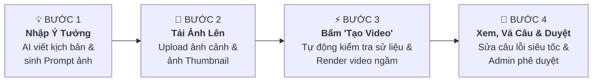
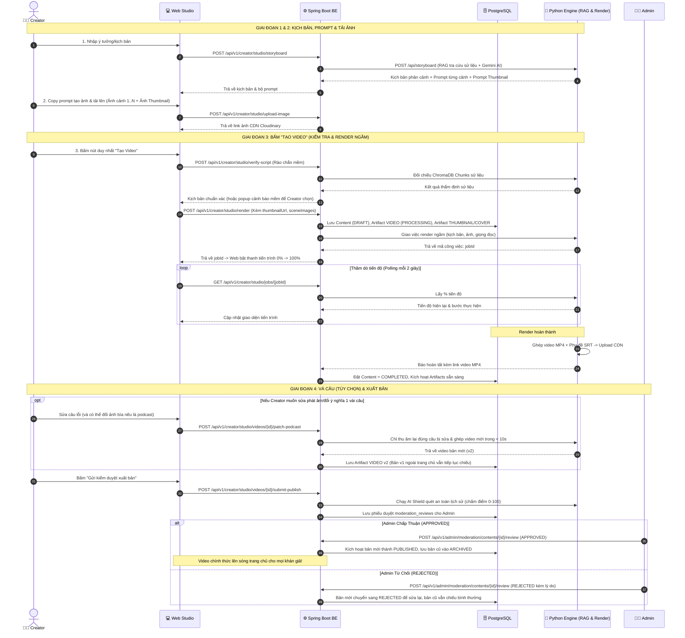

# 🎬 HƯỚNG DẪN TOÀN DIỆN: QUY TRÌNH TẠO VIDEO LỊCH SỬ DÀNH CHO CREATOR

> **Phiên bản:** 3.0 (Tối ưu hóa diễn giải logic, trực quan và dễ hiểu nhất)  
> **Áp dụng cho:** Nền tảng Kể chuyện & Podcast Lịch sử Việt Nam (PRM History Podcast).

---

## 📌 MỤC LỤC
1. [Bức Tranh Tổng Quan: Hành Trình 4 Giai Đoạn](#1-bức-tranh-tổng-quan-hành-trình-4-giai-đoạn)
2. [Phân Biệt 2 Khái Niệm Quan Trọng Dễ Nhầm Lẫn](#2-phân-biệt-2-khái-niệm-quan-trọng-dễ-nhầm-lẫn)
   - [So sánh Video Vẽ Tay (Whiteboard) vs Audio Podcast](#a-video-vẽ-tay-whiteboard-vs-video-audio-podcast)
   - [So sánh Ảnh Bìa Podcast (Cover) vs Ảnh Thumbnail Video](#b-ảnh-bìa-podcast-coverimage-vs-ảnh-thumbnail-video-thumbnailurl)
3. [Chi Tiết 4 Giai Đoạn Từ Ý Tưởng Đến Khi Xuất Bản](#3-chi-tiết-4-giai-đoạn-từ-ý-tưởng-đến-khi-xuất-bản)
   - [Giai đoạn 1: Nhập ý tưởng -> AI viết kịch bản & Gợi ý sẵn Prompt tạo ảnh](#giai-đoạn-1-nhập-ý-tưởng---ai-viết-kịch-bản--gợi-ý-sẵn-prompt-tạo-ảnh)
   - [Giai đoạn 2: Tạo ảnh bên ngoài & Tải lên hệ thống](#giai-đoạn-2-tạo-ảnh-bên-ngoài--tải-ảnh-lên-hệ-thống)
   - [Giai đoạn 3: Bấm duy nhất nút "Tạo Video" (Hệ thống tự động làm ngầm)](#giai-đoạn-3-bấm-duy-nhất-nút-tạo-video-hệ-thống-tự-động-làm-ngầm)
   - [Giai đoạn 4: Xem trước, Vá kịch bản theo câu (nếu cần) & Gửi Admin duyệt](#giai-đoạn-4-xem-trước-vá-kịch-bản-theo-câu-nếu-cần--gửi-admin-duyệt)
4. [Sơ Đồ Kỹ Thuật Tuần Tự (Sequence Diagram)](#4-sơ-đồ-kỹ-thuật-tuần-tự-sequence-diagram)
5. [Danh Mục 16 API Endpoints Dành Cho Lập Trình Viên](#5-danh-mục-16-api-endpoints-dành-cho-lập-trình-viên)

---

## 1. Bức Tranh Tổng Quan: Hành Trình 4 Giai Đoạn

Quy trình tạo video được thiết kế để Creator **chỉ cần tập trung vào sáng tạo nội dung**, toàn bộ phần việc kỹ thuật nặng nhọc (tra cứu sử liệu, tính toán thời lượng, vẽ nét tay hoạt họa, ghép phụ đề, nén video) đều do AI và hệ thống tự động xử lý:



---

## 2. Phân Biệt 2 Khái Niệm Quan Trọng Dễ Nhầm Lẫn

### A. Video Vẽ Tay (`whiteboard`) vs Video Audio Podcast (`audio_podcast`)

| Tiêu chí | 🖌️ Video Bảng Trắng Vẽ Tay (`whiteboard`) | 🎙️ Video Audio Podcast (`audio_podcast`) |
|---|---|---|
| **Hình thức hiển thị** | Từng nét vẽ phác thảo tay xuất hiện dần theo giọng đọc trên nền giấy cổ (giống phong cách vẽ hoạt họa). | Ảnh bìa tĩnh đặt ở trung tâm, xung quanh là hiệu ứng sóng âm động nhảy theo giọng đọc podcast. |
| **Yêu cầu hình ảnh** | **Bắt buộc phải có ảnh cho từng cảnh** (Cảnh 1, Cảnh 2, Cảnh 3...). | **Chỉ cần duy nhất 1 ảnh bìa** (`coverImage`) làm nền trung tâm. |
| **Độ dài & Định dạng** | Tỷ lệ ngang **16:9** (1920x1080), thời lượng 30s – 180s. | Tỷ lệ **1:1** hoặc **16:9**, thời lượng linh hoạt (1 – 15 phút). |
| **Thời gian render** | 2 – 5 phút (do máy tính phải bóc tách vector vẽ từng khung hình). | 30 – 60 giây (ghép nhanh âm thanh và hình nền). |

---

### B. Ảnh Bìa Podcast (`coverImage`) vs Ảnh Thumbnail Video (`thumbnailUrl`)

Hai loại ảnh này phục vụ mục đích khác nhau:

```
+------------------------------------------------------------------------------------+
| TRANG CHỦ / FEED KHÁM PHÁ (YouTube / Web / App):                                   |
|                                                                                    |
|  [ THUMBNAIL / POSTER ]  --> Tấm ảnh tĩnh 16:9 thu hút người xem click vào         |
|  "ĐẠI THẮNG BẠCH ĐẰNG"       (Được lưu ở trường thumbnailUrl, áp dụng cho cả 2 loại) |
+------------------------------------------------------------------------------------+
         │
         ▼ (Người xem bấm nút Play ▶️)
+------------------------------------------------------------------------------------+
| NỘI DUNG PHÁT BÊN TRONG VIDEO:                                                     |
|                                                                                    |
|  * Nếu là Video Vẽ Tay:   Màn hình vẽ tranh Cảnh 1 -> Cảnh 2 -> Cảnh 3...          |
|  * Nếu là Audio Podcast:  Màn hình hiển thị [ ẢNH BÌA PODCAST - coverImage ]       |
|                           kèm sóng âm nhảy múa và phụ đề chạy chữ bên dưới.        |
+------------------------------------------------------------------------------------+
```

- **Ảnh Bìa Podcast (`coverImage`)**: Là **nội dung nhìn thấy bên trong video Podcast**. Vì podcast không có các cảnh vẽ hoạt họa, hệ thống lấy ảnh bìa này đặt làm tâm điểm hiển thị của toàn bộ video MP4.
- **Ảnh Thumbnail (`thumbnailUrl`)**: Là **tấm biển quảng cáo ngoài rạp (Poster)**. Nó xuất hiện trên thẻ video ở Trang chủ / Tìm kiếm / Danh sách phát để người xem nhìn thấy trước khi bấm nút Play. Áp dụng cho cả Video vẽ tay lẫn Video podcast.

---

## 3. Chi Tiết 4 Giai Đoạn Từ Ý Tưởng Đến Khi Xuất Bản

### Giai đoạn 1: Chọn định dạng, Nhập ý tưởng -> AI viết kịch bản & Gợi ý Prompt tạo ảnh

#### 1. Creator làm gì?
Khi mở Creator Studio, Creator thực hiện 3 thao tác đầu tiên:

##### 🔘 Thao tác 1: Chọn Định dạng video muốn tạo (`renderMode`)
Creator bấm chọn 1 trong 2 định dạng hiển thị ngay đầu trang:
- 🎙️ **Lựa chọn 1 - Audio Podcast Video (`audio_podcast`)**:
  - *Đặc điểm*: Dành cho nội dung podcast kể chuyện, bình luận lịch sử, tâm sự truyền cảm.
  - *Ưu điểm*: **Cực nhanh và tiện lợi**: Chỉ cần **duy nhất 1 ảnh bìa** (`coverImage`), không cần vẽ ảnh từng cảnh. Thời gian render chỉ 30 – 60 giây. Sau này hỗ trợ tính năng **Vá kịch bản theo câu siêu tốc (Smart Patching)**.
- 🖌️ **Lựa chọn 2 - Hoạt Họa Bảng Trắng (`whiteboard`)**:
  - *Đặc điểm*: Dành cho video tái hiện diễn biến trận đánh, giai thoại lịch sử có hình ảnh trực quan sinh động.
  - *Yêu cầu*: Cần có ảnh minh họa cho **từng phân cảnh** (Cảnh 1, Cảnh 2...) để máy tính bóc tách nét vẽ tay dòng mực dần xuất hiện trên nền giấy cổ. Thời gian render: 2 – 5 phút.

##### 🔘 Thao tác 2: Nhập nội dung (Chọn 1 trong 2 cách)
Sau khi chọn định dạng, Creator nhập nội dung vào ô văn bản:

| Cách nhập | Ví dụ đầu vào | Ý nghĩa thực tế |
|---|---|---|
| **🟢 Cách 1: Chỉ nhập Tiêu đề ngắn** (< 100 ký tự) | *"Trận Như Nguyệt 1077"* hoặc *"Hai Bà Trưng"* | Creator **chưa có kịch bản**, muốn AI tự động nghiên cứu sử liệu và viết trọn vẹn kịch bản từ A đến Z. |
| **🔵 Cách 2: Dán Kịch bản có sẵn** (Đoạn văn dài $\ge$ 100 ký tự) | Đoạn văn bản kịch bản hoàn chỉnh do Creator tự chuẩn bị | Creator **đã có kịch bản của riêng mình**, chỉ muốn hệ thống chia cảnh, đọc lồng tiếng và dựng video chứ **tuyệt đối không được sửa đổi câu chữ**. |

##### 🔘 Thao tác 3: Chọn Giọng đọc AI & Thời lượng
- Chọn giọng đọc AI yêu thích (NamMinh, HoaiMy,...) từ danh mục giọng đọc tiếng Việt.
- Chọn thời lượng mong muốn (30s, 60s, 90s, 180s...).
- Bấm nút **"Tạo Phân Cảnh & Kịch Bản"** (`POST /storyboard`).

#### 2. AI & Hệ thống xử lý khác nhau như thế nào giữa 2 cách nhập?

- **Nếu Creator chọn Cách 1 (Chỉ nhập Tiêu đề ngắn)**:
  1. **AI đóng vai Biên kịch lịch sử**: Dùng công nghệ **RAG** truy vấn kho tài liệu sử gốc (*Đại Việt Sử Ký Toàn Thư*, *Khâm Định Việt Sử Thông Giám Cương Mục*) để lấy chính xác mốc năm, nhân vật và sự kiện có thật.
  2. **Tự động viết kịch bản mới 100%**: Gemini AI sáng tác kịch bản hoàn chỉnh, đĩnh đạc theo phong cách phim tài liệu, khớp đúng thời lượng đã chọn.
  3. **Tự động phân bổ cấu trúc**:
     - *Với Audio Podcast*: Tạo bài thuyết minh liền mạch theo mạch cảm xúc.
     - *Với Video Bảng Trắng*: Chia kịch bản thành các phân cảnh hợp lý (ví dụ: video 60s chia thành 2 cảnh, mỗi cảnh ~30s).
  4. **Tự động sinh Prompt ảnh**: Sinh prompt ảnh phù hợp với định dạng đã chọn.

- **Nếu Creator chọn Cách 2 (Dán Kịch bản có sẵn)**:
  1. **TÔN TRỌNG NGUYÊN TÁC 100%**: Hệ thống **TUYỆT ĐỐI KHÔNG dùng AI viết lại, không tự ý sửa đổi hay bịa thêm nội dung** vào câu chữ của Creator.
  2. **Chỉ làm nhiệm vụ biên tập & chia thời lượng**: Cắt đoạn văn bản gốc của Creator thành các câu/cảnh vừa vặn với thời lượng (để khi chuyển thành giọng đọc AI thì tốc độ đọc tự nhiên, không bị quá vội hoặc quá chậm).
  3. **Tự động sinh Prompt ảnh**: Đọc hiểu nội dung từng đoạn của Creator để gợi ý prompt vẽ tranh minh họa tương ứng.

#### 3. Bộ Prompt ảnh AI trả về theo định dạng video:
- **Nếu chọn Audio Podcast (`audio_podcast`)**: AI trả về `thumbnail_prompt` — prompt tạo **Ảnh Bìa Podcast** nghệ thuật (tỷ lệ 1:1 hoặc 16:9). Creator chỉ cần tạo duy nhất 1 bức ảnh này.
- **Nếu chọn Video Bảng Trắng (`whiteboard`)**: AI trả về đầy đủ:
  - `image_prompt`: Prompt vẽ tranh phác thảo doodle 16:9 cho từng cảnh (Cảnh 1, Cảnh 2, Cảnh 3...).
  - `thumbnail_prompt`: Prompt tạo **Ảnh Thumbnail Poster** 16:9 điện ảnh hoành tráng để làm ảnh bìa ngoài trang chủ.

#### 4. Màn hình hiển thị gì?
- Kịch bản chi tiết hiển thị trực quan để Creator tự do đọc duyệt và chỉnh sửa từng từ ngữ theo ý muốn.
- Có sẵn nút **"Copy Prompt"** tiện lợi để Creator sao chép mang sang Midjourney / DALL-E tạo ảnh.

---

### Giai đoạn 2: Tạo ảnh bên ngoài & Tải ảnh lên hệ thống

1. **Creator làm gì?**
   - Creator bấm nút copy prompt từ Bước 1 sang các công cụ AI tạo ảnh (Midjourney, DALL-E 3, Bing Image Creator, Leonardo AI, Canva,...).
   - Lưu ảnh về máy tính.
   - Chuyển sang màn hình Tải ảnh:
     - **Với Video Vẽ Tay (`whiteboard`)**: Tải ảnh vào ô **Cảnh 1, Cảnh 2, Cảnh 3...** (bắt buộc). Đồng thời có thêm ô **"Ảnh Thumbnail đại diện (Tùy chọn)"** để tải tấm poster đẹp nhất lên.
     - **Với Video Audio Podcast (`audio_podcast`)**: Tải 1 ảnh duy nhất vào ô **"Ảnh Bìa Podcast"**.
2. **Hệ thống làm gì?**
   - Mỗi khi Creator chọn tệp ảnh tải lên, hệ thống tự động gửi ảnh lên Cloudinary CDN (`POST /upload-image`) và nhận về đường link ảnh an toàn (`https://res.cloudinary.com/...`).
   - Link ảnh Thumbnail được lưu sẵn vào bộ nhớ để chuẩn bị gửi sang Bước 3.

---

### Giai đoạn 3: Bấm duy nhất nút "Tạo Video" (Hệ thống tự động làm ngầm)

1. **Creator làm gì?**
   - Creator kiểm tra lại lần cuối và bấm **duy nhất 1 nút "Bắt Đầu Tạo Video"**.
2. **Hệ thống tự động thực thi 2 nhịp ngầm phía sau:**
   - **Nhịp 1 - Rào chắn mềm kiểm tra sử liệu (`POST /verify-script`)**:
     - Màn hình tạm hiển thị: *"🔍 Đang đối chiếu sử liệu..."* trong 1-2 giây.
     - Hệ thống đối chiếu kịch bản với kho chunks dữ liệu sử liệu.
     - **Nếu kịch bản chuẩn xác**: Hệ thống **tự động chạy thẳng sang Nhịp 2** trong tích tắc mà không làm phiền người dùng.
     - **Nếu kịch bản có nghi vấn sử liệu**: Hệ thống bật một popup cảnh báo mềm, trích dẫn rõ sách sử nói gì và đề xuất câu sửa. Creator có 2 lựa chọn:
       + Bấm *"Áp dụng câu sửa của AI"* $\rightarrow$ Kịch bản cập nhật chuẩn ngay.
       + Bấm *"Bảo lưu quan điểm, Vẫn tạo video"* $\rightarrow$ Hệ thống hoàn toàn tôn trọng ý kiến Creator và tiếp tục sản xuất.
   - **Nhịp 2 - Kích hoạt sản xuất video (`POST /render`)**:
     - Web gửi toàn bộ thông tin sang Backend: tiêu đề, kịch bản, ảnh các cảnh, giọng đọc, và **trường `thumbnailUrl` (ảnh thumbnail mà Creator đã tải lên ở Giai đoạn 2)**.
     - **Backend lưu ngay hồ sơ vào Database (~0.05 giây)**:
       + Lưu Video ở trạng thái `DRAFT` (Bản nháp).
       + Lưu tệp video trạng thái `PROCESSING` (Đang render) với `version = 1`.
       + Lưu ảnh Thumbnail do Creator gửi lên vào bảng `artifacts` (`type = 'THUMBNAIL'`). *(Nếu lúc này Creator chưa kịp tải ảnh thumbnail riêng, hệ thống tự động lấy tạm ảnh Cảnh 1 làm dự phòng để video không bao giờ bị rỗng ảnh bìa ngoài trang chủ).*
     - **Giao việc cho Python Engine chạy ngầm**: Backend chuyển giao việc cho Python Render Engine, nhận về một mã vé gọi là **`jobId`** (ví dụ: `job_8f29d10a`).
3. **Màn hình hiển thị gì?**
   - Web nhận được `jobId` liền bật ngay **Thanh tiến trình (Progress Bar)** hiển thị 6 bước trực quan:
     1. Khởi tạo tác vụ & nạp dữ liệu phân cảnh.
     2. Tải ảnh phân cảnh từ CDN về máy chủ render.
     3. Thu âm lồng tiếng AI (TTS Edge / ElevenLabs).
     4. Tạo phụ đề SRT đồng bộ chính xác từng phần trăm giây.
     5. Biên dịch khung hình nét vẽ tay / Ghép hiệu ứng video MP4.
     6. Đẩy video thành phẩm lên Cloudinary CDN $\rightarrow$ Hoàn tất 100%!

> [!TIP]
> **Không sợ mất dữ liệu:** Quá trình render chạy hoàn toàn ngầm trên máy chủ. Kể cả Creator có tắt trình duyệt hay mất mạng, video vẫn được máy chủ vẽ xong và lưu an toàn vào Thư viện của Creator.

---

### Giai đoạn 4: Xem trước, Vá kịch bản theo câu (nếu cần) & Gửi Admin duyệt

1. **Xem trước trong Thư viện:**
   - Video sau khi hoàn thành có trạng thái `COMPLETED` (nằm an toàn trong Thư viện cá nhân của Creator, chưa ai bên ngoài nhìn thấy).
   - Creator mở video xem lại hình ảnh, nghe giọng đọc và xem phụ đề.
   - Nếu muốn đổi ảnh Thumbnail khác: Creator bấm nút "Đổi Thumbnail" (`POST /videos/{id}/thumbnail` hoặc `PUT /videos/{id}`) để thay ảnh bìa mới bất cứ lúc nào.
2. **Vá kịch bản siêu tốc theo từng câu (Smart Script Patching) - Tùy chọn:**
   - Nếu nghe lại thấy 1 từ phát âm chưa chuẩn (ví dụ chữ *"Bạch Đằng"* đọc chưa vang) hoặc muốn đổi ý 1 câu:
   - **Không cần tạm ẩn video**: Nếu video đang phát sóng công khai ngoài trang chủ (`PUBLISHED`), bản `v1` cũ vẫn tiếp tục chiếu cho khán giả xem bình thường, không bị gián đoạn hay mất lượt xem!
   - Creator mở công cụ vá: Hệ thống hiển thị từng câu kèm nút nghe thử riêng biệt của câu đó (`GET /podcast-sentences`).
   - Creator sửa lại chữ câu cần sửa (và có thể chọn đổi ảnh bìa mới nếu là Podcast) $\rightarrow$ Bấm **"Vá Video"** (`POST /patch-podcast`).
   - **Python Engine chỉ thu âm lại đúng 1 câu bị sửa**, tận dụng lại 100% âm thanh của các câu khác và dùng FFmpeg ghép lại video mới trong chưa đầy **10 giây** (tiết kiệm 90% thời gian và chi phí API so với việc render lại từ đầu).
   - Hệ thống tạo ra một phiên bản mới `v2` độc lập với trạng thái `COMPLETED`.
3. **Gửi kiểm duyệt xuất bản (`POST /submit-publish`):**
   - Khi Creator đã ưng ý với tác phẩm, bấm **"Gửi Kiểm Duyệt Xuất Bản"**.
   - **Lớp 1 - AI Shield tự động**: Quét video và kịch bản, chấm điểm an toàn nội dung lịch sử (0 – 100 điểm) và xếp hạng mức độ an toàn.
   - **Lớp 2 - Admin Phê Duyệt**:
     - Admin mở phiếu duyệt trong trang Quản trị kèm theo kết quả chấm điểm của AI Shield.
     - **Admin bấm DUYỆT (`APPROVED`)**: Video (hoặc bản vá `v2`) chính thức chuyển sang trạng thái `PUBLISHED` và phát sóng ra trang chủ. Bản `v1` cũ tự động lưu vào kho lưu trữ (`ARCHIVED`). Người xem luôn được thưởng thức phiên bản hoàn hảo nhất!
     - **Admin bấm TỪ CHỐI (`REJECTED`)**: Hệ thống ghi rõ lý do để Creator chỉnh sửa lại. Bản cũ đang phát sóng vẫn hoạt động bình thường, không bị gián đoạn.

---

## 4. Sơ Đồ Kỹ Thuật Tuần Tự (Sequence Diagram)



---

## 5. Danh Mục 16 API Endpoints Dành Cho Lập Trình Viên

| STT | Phương thức | Đường dẫn API | Chức năng nghiệp vụ |
|:---:|:---:|---|---|
| **1** | `GET` | `/api/v1/creator/studio/settings` | Xem cấu hình API Key (Gemini, ElevenLabs) và giọng đọc mặc định. |
| **2** | `PUT` | `/api/v1/creator/studio/settings` | Cập nhật cấu hình API Key cá nhân của Creator. |
| **3** | `POST` | `/api/v1/creator/studio/voices/preview` | Tạo file âm thanh nghe thử giọng đọc AI trực tiếp trên web. |
| **4** | `POST` | `/api/v1/creator/studio/storyboard` | Sinh phân cảnh kịch bản, **gợi ý prompt vẽ từng cảnh và prompt ảnh Thumbnail**. |
| **5** | `POST` | `/api/v1/creator/studio/verify-script` | Kiểm tra độ chuẩn xác sử liệu với kho chunks ChromaDB (Rào chắn mềm). |
| **6** | `POST` | `/api/v1/creator/studio/upload-image` | Tải tệp ảnh minh họa phân cảnh / ảnh bìa / thumbnail lên Cloudinary CDN. |
| **7** | `POST` | `/api/v1/creator/studio/render` | Bắt đầu sản xuất video: Lưu DB (DRAFT) + Giao việc ngầm cho Python (nhận `thumbnailUrl`, `coverImage`). |
| **8** | `GET` | `/api/v1/creator/studio/jobs/{jobId}` | Thăm dò tiến độ render video (Web gọi tự động mỗi 2 giây). |
| **9** | `GET` | `/api/v1/creator/studio/videos` | Lấy danh sách toàn bộ video kèm ảnh `thumbnailUrl` trong Thư viện của Creator. |
| **10** | `GET` | `/api/v1/creator/studio/videos/{contentId}` | Xem thông tin chi tiết video, số lượt xem/thích và ảnh `thumbnailUrl`. |
| **11** | `PUT` | `/api/v1/creator/studio/videos/{contentId}` | Sửa tiêu đề, mô tả, hoặc **cập nhật lại đường dẫn ảnh `thumbnailUrl`**. |
| **12** | `POST` | `/api/v1/creator/studio/videos/{contentId}/thumbnail` | **Creator tải trực tiếp file ảnh Thumbnail từ máy tính lên Cloudinary** để gán cho video. |
| **13** | `PATCH` | `/api/v1/creator/studio/videos/{contentId}/visibility` | Ẩn hoặc Hiện video đã xuất bản (`PUBLISHED` $\leftrightarrow$ `HIDDEN`). |
| **14** | `GET` | `/api/v1/creator/studio/videos/{contentId}/podcast-sentences` | Lấy danh sách từng câu thoại kèm file audio riêng lẻ để nghe thử trước khi vá câu. |
| **15** | `POST` | `/api/v1/creator/studio/videos/{contentId}/patch-podcast` | Vá các câu kịch bản theo yêu cầu (hỗ trợ đổi ảnh bìa `coverImage` cho podcast) và tạo video mới trong < 10s. |
| **16** | `POST` | `/api/v1/creator/studio/videos/{contentId}/submit-publish` | Chạy thẩm định an toàn AI Shield và nộp phiếu kiểm duyệt lên Admin. |

---
*Tài liệu nội bộ dự án PRM - Nền tảng Kể chuyện & Podcast Lịch sử Việt Nam.*
