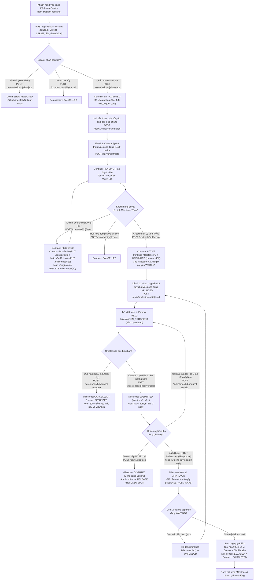
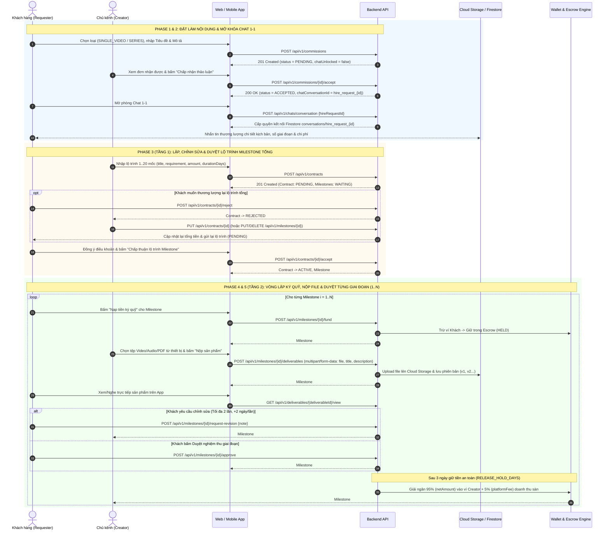

# Hướng dẫn Luồng Đặt làm Nội dung, Thương lượng & Ký quỹ Milestone (Reversed Commission & Milestone Escrow Flow)

Tài liệu này mô tả chi tiết kiến trúc, luồng nghiệp vụ từ đầu đến cuối (End-to-End), sơ đồ trạng thái, quy tắc thiết kế giao diện (UI/UX Rules) và danh mục toàn bộ API cho tính năng **Khách hàng đặt Creator làm nội dung theo yêu cầu & Thanh toán ký quỹ theo từng giai đoạn Milestone (Escrow)** trên Web và Mobile App.

---

## 1. Tổng quan Kiến trúc & Quy tắc Cốt lõi

Trong kiến trúc mới (đã loại bỏ hoàn toàn mô hình Chợ việc làm / Tuyển dụng giọng đọc V1 cũ):
* **Người đặt nội dung (`Customer / Requester / Listener`):** Khán giả xem kênh, chủ động gửi yêu cầu đặt **Creator (Chủ kênh)** sản xuất **Video lẻ (`SINGLE_VIDEO`)** hoặc **Chuỗi nhiều tập (`SERIES`)** theo chủ đề lịch sử mong muốn.
* **Người thực hiện (`Creator`):** Chủ kênh nhận yêu cầu, trao đổi với Khách hàng qua phòng Chat 1-1, lập **Lộ trình Milestone tổng** (`1..20` giai đoạn) và bàn giao sản phẩm theo từng giai đoạn để nhận giải ngân từ quỹ bảo증 **Escrow**.

### 7 Quy tắc Nghiệp vụ Toàn Hệ thống
1. **Giới hạn 1 Đơn đang chạy (`1 Active Commission Rule`):** Mỗi Khách hàng tại một thời điểm chỉ được có **tối đa 1 đơn đặt nội dung đang hoạt động** (`PENDING`, `ACCEPTED`, `CONTRACT_SENT`). Phải đợi đơn hiện tại hoàn tất (`COMPLETED`), bị từ chối (`REJECTED`) hoặc hủy (`CANCELLED`) mới được đặt đơn mới.
2. **Chỉ nhận đặt Video lẻ hoặc Series:** `contentType` chỉ chấp nhận `SINGLE_VIDEO` hoặc `SERIES` (**không** có `LIVESTREAM` trong luồng đặt hàng).
3. **Khóa phòng Chat 1-1 trước khi Creator nhận đơn:** Khi đơn mới tạo (`PENDING`), hai bên chưa thể nhắn tin. Chỉ khi Creator bấm **Chấp nhận (`ACCEPTED`)**, hệ thống mới cấp mã phòng chat `hire_request_{commissionId}` trên Firebase Firestore.
4. **Duyệt Milestone 2 Tầng rõ rệt:**
   * **Tầng 1 — Thương lượng & Duyệt Lộ trình Milestone TỔNG lúc đầu (Contract Level):** Creator tạo lộ trình từ `1` đến tối đa `20` giai đoạn (`POST /api/v1/contracts`). Khi hợp đồng còn ở `PENDING` hoặc `REJECTED` (chưa đóng cọc), Khách hàng có thể **Chấp thuận toàn bộ lộ trình (`accept`)** hoặc **Từ chối để thương lượng lại (`reject`)**; Creator có thể **Sửa toàn bộ lộ trình (`PUT /api/v1/contracts/{id}`)**, **Sửa lẻ 1 mốc (`PUT /api/v1/milestones/{id}`)**, hoặc **Xóa/Gộp mốc (`DELETE /api/v1/milestones/{id}`)**.
   * **Tầng 2 — Đóng cọc, Nộp thành phẩm & Duyệt Nghiệm thu THEO TỪNG GIAI ĐOẠN (Stage-by-Stage Level):** Khách hàng **không phải đóng cọc một cục 100% hợp đồng ngay từ đầu**. Khi duyệt lộ trình tổng, hệ thống chỉ mở khóa **duy nhất Milestone #1** sang `UNFUNDED`. Chỉ khi giai đoạn trước được Khách hàng duyệt nghiệm thu (`APPROVED`), giai đoạn kế tiếp mới tự động mở khóa từ `WAITING` sang `UNFUNDED`.
5. **Bàn giao thành phẩm bằng File Picker (Giống đăng Video bình thường, nhưng Riêng tư):** Creator chọn tệp trực tiếp từ máy tính/điện thoại (Video `.mp4/.mov`, Audio `.mp3/.wav`, Kịch bản `.pdf/.docx/.zip`) để tải lên. Sản phẩm bàn giao được bảo mật riêng tư trong hợp đồng (chỉ Khách đặt hàng, Creator và Admin được xem/tải), **không** tự động đăng công khai lên kênh.
6. **Cơ chế Bảo vệ Kép & Giải ngân `95% / 5%`:**
   * Mỗi giai đoạn có tối đa **2 lần yêu cầu chỉnh sửa miễn phí** (`maxRevisions = 2`), mỗi lần sửa cộng thêm **+2 ngày** (`revisionDays = 2`).
   * Sau khi Creator nộp bài (`SUBMITTED`), Khách hàng có **3 ngày** (`reviewDays = 3`) để nghiệm thu. Quá 3 ngày không phản hồi, hệ thống **tự động duyệt (`APPROVED`)**.
   * Nếu Creator trễ hạn bàn giao (`dueAt`), Khách hàng được quyền bấm **Hủy giai đoạn trễ hạn (`cancel-overdue`)** để nhận hoàn tiền **100%** giai đoạn đó về ví ngay lập tức.
   * Sau khi giai đoạn được duyệt (`APPROVED`), hệ thống giữ tiền an toàn **3 ngày** (`releaseHoldDays = 3`) rồi tự động giải ngân **95%** (`netAmount`) vào ví khả dụng của Creator và thu **5%** (`platformFee`) phí nền tảng (`RELEASED`).
7. **Chính sách Tài chính Đồng bộ Toàn Nền tảng:**
   * **Đặt làm nội dung (Commission Milestone Escrow):** Phí sàn **5%** — Creator thực nhận **95%** (Tối소 mỗi mốc `10.000đ`, tối đa `20` mốc).
   * **Gói hội viên kênh (Channel Membership):** Phí sàn **10%** — Creator thực nhận **90%** (Chu kỳ **30 ngày**, giá tối thiểu `10.000đ`).
   * **Nạp ví & Rút tiền (Wallet & Withdrawal):** Nạp tối thiểu `10.000đ` (tự động qua VietQR PayOS); Rút tối thiểu `50.000đ`, miễn phí rút (`0%`), cam kết xử lý tối đa **2 ngày (48h)**.

---

## 2. Sơ đồ Luồng Tổng quan (Mermaid Flowchart)



---

## 3. Bảng Ánh xạ Vai trò & Từ điển Trường Dữ liệu (Tránh Nhầm lẫn cho FE & Mobile)

Do hệ thống giữ lại một số trường JSON cũ để tương thích ngược (Backward Compatibility), FE và Mobile cần nắm rõ bảng quy đổi sau:

| Khái niệm Thực tế | Trường Khuyên dùng trên JSON (Chuẩn Mới) | Trường Tương thích ngược (Cũ — Cùng giá trị) | Giải thích rõ |
| :--- | :--- | :--- | :--- |
| **Đơn đặt làm nội dung** | `commissionId` | `hireRequestId` | ID của đơn đặt hàng do Khách gửi cho kênh. |
| **Khách hàng (Người đặt nội dung & Trả tiền)** | `requesterId`, `requesterFullName`, `requesterAvatarUrl`, `requesterEmail` | `narratorId`, `freelancerId`, `freelancerFullName`, `freelancerAvatarUrl` | **Lưu ý cực kỳ quan trọng:** Trong bảng `contracts` và JSON trả về, `requester` (hay `freelancer`/`narrator` cũ) chính là **Khách hàng bỏ tiền thuê**. |
| **Chủ kênh (Người sản xuất & Nhận tiền 95%)** | `creatorId`, `creatorFullName`, `creatorAvatarUrl`, `creatorEmail` | `creatorId`, `creatorFullName` | Chủ kênh nhận yêu cầu, lập Milestone, nộp sản phẩm và nhận 95% tiền giải ngân. |
| **Kênh được đặt hàng** | `channelId`, `channelName`, `channelSlug` | — | Kênh của Creator mà Khách hàng đã bấm "Đặt làm nội dung". |
| **Loại nội dung đặt làm** | `contentType` (`SINGLE_VIDEO` \| `SERIES`) | `serviceType` (`CONTENT`) | Chỉ nhận làm Video lẻ hoặc Chuỗi nhiều tập. |

### Bảng Trạng thái Các Thực thể (State Machine & Enum Dictionary)

| Thực thể | Các Trạng thái (`Enum`) | Ý nghĩa Chi tiết |
| :--- | :--- | :--- |
| **`CommissionStatus`**<br>(Đơn đặt nội dung) | `PENDING` | Khách vừa gửi đơn, chờ Creator phản hồi (Phòng Chat 1-1 đang khóa). |
| | `ACCEPTED` | Creator đã nhận đơn thảo luận -> Mở khóa phòng Chat 1-1 (`hire_request_{id}`). |
| | `REJECTED` | Creator từ chối đơn (kèm `rejectionReason`) -> Giải phóng slot cho Khách đặt kênh khác. |
| | `CONTRACT_SENT` | Creator đã lập và gửi Lộ trình Milestone tổng (`Contract`) cho Khách duyệt. |
| | `COMPLETED` | Toàn bộ các giai đoạn Milestone đã hoàn thành và giải ngân xong. |
| | `CANCELLED` | Đơn bị hủy trước khi hoàn thành -> Giải phóng slot cho Khách. |
| **`ContractStatus`**<br>(Hợp đồng tổng) | `PENDING` | Creator vừa gửi hoặc gửi lại Lộ trình Milestone tổng, chờ Khách duyệt trong 48h. |
| | `REJECTED` | Khách từ chối Lộ trình tổng để thương lượng lại (Creator được sửa/xóa/gộp mốc và gửi lại). |
| | `ACTIVE` | Khách đã duyệt Lộ trình tổng, đang chạy từng giai đoạn Milestone (`#1..#N`). |
| | `COMPLETED` | Tất cả các giai đoạn Milestone trong hợp đồng đã giải ngân (`RELEASED`). |
| | `CANCELLED` | Hợp đồng bị hủy (trước khi cọc, hoặc do hủy mốc trễ hạn / Admin xử hoàn tiền). |
| **`MilestoneStatus`**<br>(Từng giai đoạn `#1..#N`) | `WAITING` | Đang khóa, chờ giai đoạn đứng trước được nghiệm thu (`APPROVED`) mới mở khóa. |
| | `UNFUNDED` | Đã mở khóa, chờ Khách hàng nạp tiền ký quỹ trong 48h (`fundDueAt`). |
| | `IN_PROGRESS` | Khách đã nạp cọc (`Escrow = HELD`), Creator đang làm bài (hoặc đang sửa bài theo yêu cầu). |
| | `SUBMITTED` | Creator đã tải lên file thành phẩm, chờ Khách nghiệm thu trong 3 ngày (`reviewDueAt`). |
| | `APPROVED` | Khách đã bấm Duyệt (hoặc tự động duyệt sau 3 ngày), đang giữ tiền 3 ngày (`releaseAvailableAt`) & mở khóa mốc kế tiếp sang `UNFUNDED`. |
| | `RELEASED` | Đã hết 3 ngày giữ tiền -> Giải ngân **95%** vào ví Creator + **5%** phí sàn. |
| | `DISPUTED` | Đang có khiếu nại/tranh chấp (`Escrow = FROZEN`), chờ Admin phân xử. |
| | `CANCELLED` | Giai đoạn bị hủy (do Creator trễ hạn `dueAt` hoặc Admin xử hoàn tiền 100% cho Khách). |
| **`EscrowStatus`**<br>(Trạng thái tiền cọc) | `NONE` -> `HELD` -> `FROZEN` -> `RELEASED` / `REFUNDED` | `NONE`: Chưa nạp cọc; `HELD`: Đang giữ an toàn trong quỹ bảo chứng; `FROZEN`: Đóng băng do tranh chấp; `RELEASED`: Đã giải ngân cho Creator; `REFUNDED`: Đã hoàn trả cho Khách hàng. |

---

## 4. Chi tiết Quy trình Từng Giai đoạn (Step-by-Step Lifecycle)

### Phase 1: Khách hàng Gửi đơn Đặt làm Nội dung & Creator Phản hồi

#### Bước 1.1: Khách hàng gửi đơn đặt hàng (`POST /api/v1/commissions`)
Khách hàng truy cập trang Kênh của Creator và bấm nút **"Đặt làm nội dung"**.
* **Endpoint:** `POST /api/v1/commissions` (hoặc alias `/api/v1/hire-requests`)
* **Request Body:**
```json
{
  "channelId": 12,
  "contentType": "SERIES",
  "title": "Chuỗi 3 tập giải mã chiến thuật trận Bạch Đằng năm 938 và 1288",
  "description": "Mình muốn đặt kênh sản xuất chuỗi 3 tập phân tích địa hình sông Bạch Đằng, có bản đồ minh họa 2D và giọng đọc hào hùng."
}
```
* **Kết quả:** Đơn chuyển sang trạng thái `PENDING` (`chatUnlocked = false`).

#### Bước 1.2: Creator phản hồi đơn đặt hàng
* **Chấp nhận đơn để mở phòng Chat 1-1:**
  * **Endpoint:** `POST /api/v1/commissions/{id}/accept`
  * **Kết quả:** Đơn chuyển sang `ACCEPTED`, `chatUnlocked = true`, cấp mã `chatConversationId = "hire_request_{id}"`.
* **Từ chối đơn (Bắt buộc nhập lý do):**
  * **Endpoint:** `POST /api/v1/commissions/{id}/reject`
  * **Request Body:** `{ "rejectionReason": "Hiện tại lịch sản xuất của kênh đã kín trong tháng này, hẹn bạn dịp khác nhé!" }`
  * **Kết quả:** Đơn chuyển sang `REJECTED`, giải phóng ngay giới hạn 1 đơn để Khách hàng đi đặt kênh khác.
* **Khách hàng chủ động hủy đơn (khi chưa có hợp đồng chạy):**
  * **Endpoint:** `POST /api/v1/commissions/{id}/cancel` -> Trạng thái `CANCELLED`.

---

### Phase 2: Mở Phòng Chat 1-1 Thương lượng Yêu cầu & Giá

Sau khi đơn ở trạng thái `ACCEPTED` (hoặc khi đã có `Contract`), cả hai bên mở phòng Chat 1-1:
* **Endpoint:** `POST /api/v1/chats/conversation`
* **Request Body:**
```json
{
  "hireRequestId": 45
}
```
*(Hoặc truyền `{"contractId": 102}` nếu mở từ màn hình Chi tiết Hợp đồng — cả hai đều trả về chung một phòng chat `hire_request_45`).*
* **Response:** Trả về `conversationId`, `topicTitle`, thông tin đối tác (`partnerId`, `partnerName`, `partnerAvatar`) để kết nối thẳng vào collection `conversations/{conversationId}/messages` trên Firebase Firestore.

---

### Phase 3: TẦNG 1 — Creator Lập Lộ trình Milestone Tổng & Khách hàng Duyệt Lộ trình

#### Bước 3.1: Creator lập & gửi Lộ trình Milestone Tổng (`POST /api/v1/contracts`)
Sau khi thống nhất trong phòng chat, Creator mở form **"Tạo lộ trình Milestone"** (từ `1` đến tối đa `20` giai đoạn):
* **Endpoint:** `POST /api/v1/contracts`
* **Request Body:**
```json
{
  "commissionId": 45,
  "title": "Hợp đồng sản xuất Series 3 tập Chiến thắng Bạch Đằng",
  "description": "Sản xuất trọn gói kịch bản, thu âm thuyết minh và dựng video 2D FullHD.",
  "milestones": [
    {
      "title": "Giai đoạn 1: Đề cương chi tiết & Kịch bản 3 tập",
      "requirement": "Bàn giao file PDF kịch bản phân cảnh chi tiết cho cả 3 tập",
      "amount": 300000,
      "durationDays": 3
    },
    {
      "title": "Giai đoạn 2: Bản thu âm thuyết minh & Video Tập 1",
      "requirement": "Bàn giao video MP4 FullHD Tập 1 (15 phút)",
      "amount": 700000,
      "durationDays": 5
    },
    {
      "title": "Giai đoạn 3: Hoàn thiện Video Tập 2 & Tập 3",
      "requirement": "Bàn giao 2 file video MP4 FullHD Tập 2 và Tập 3",
      "amount": 1000000,
      "durationDays": 7
    }
  ]
}
```
* **Cơ chế Tự động của Backend:**
  * Tự đánh số thứ tự `orderNo = 1, 2, 3...` theo đúng thứ tự mảng.
  * Tự áp cấu hình mặc định từ Policy: `maxRevisions = 2`, `revisionDays = 2`, `platformFeePercent = 5.0%`.
  * Tự tính cho từng mốc: `platformFee = amount * 5%`, `netAmount = amount * 95%`, và cộng tổng `totalAmount = 2.000.000 VND`.
  * Tự chụp bản điều khoản (`termsText`) đóng băng vào hợp đồng.
  * Hợp đồng ở trạng thái `PENDING` (hạn duyệt 48h `acceptDueAt`), tất cả các Milestone ở trạng thái `WAITING`.

#### Bước 3.2: Khách hàng Duyệt hoặc Từ chối Lộ trình Milestone Tổng
Trên màn hình Chi tiết Hợp đồng (`GET /api/v1/contracts/{id}`), Khách hàng xem toàn bộ danh sách Milestone dự kiến và chọn:
1. **Chấp thuận toàn bộ Lộ trình Milestone Tổng:**
   * **Endpoint:** `POST /api/v1/contracts/{id}/accept`
   * **Kết quả:**
     * Hợp đồng chuyển từ `PENDING` -> `ACTIVE`.
     * **Chỉ mở khóa duy nhất Milestone #1** từ `WAITING` -> `UNFUNDED` (hạn nạp cọc 48h `fundDueAt`).
     * Các Milestone `#2..#N` vẫn giữ nguyên `WAITING` (chưa bắt Khách nạp tiền).
2. **Từ chối Lộ trình Tổng để thương lượng lại:**
   * **Endpoint:** `POST /api/v1/contracts/{id}/reject`
   * **Kết quả:** Hợp đồng chuyển sang `REJECTED`, đơn đặt hàng quay về `ACCEPTED` để hai bên tiếp tục chat và chỉnh sửa lộ trình.

#### Bước 3.3: Creator Chỉnh sửa / Gộp / Xóa Milestone khi đang Thương lượng (`PENDING` hoặc `REJECTED`)
Khi Hợp đồng chưa nạp cọc (`PENDING` hoặc `REJECTED`), nếu Khách hàng muốn đổi giá, sửa yêu cầu hoặc gộp bớt giai đoạn, Creator có **3 API linh hoạt**:
* **Cách A — Sửa toàn bộ lộ trình & gửi lại:**
  * `PUT /api/v1/contracts/{id}` (Truyền lại `title`, `description`, mảng `milestones` mới -> Hợp đồng tự tính lại tổng tiền và chuyển về `PENDING` chờ Khách duyệt).
* **Cách B — Sửa lẻ 1 Milestone trong lộ trình:**
  * `PUT /api/v1/milestones/{id}` (Body: `{"title", "requirement", "amount", "durationDays"}` -> Tự động tính lại phí 5%/95% của mốc đó, cập nhật lại `totalAmount` của Hợp đồng và reset hạn duyệt 48h).
* **Cách C — Xóa bớt 1 Milestone (ví dụ gộp 3 mốc thành 2 mốc):**
  * `DELETE /api/v1/milestones/{id}` (Khi hợp đồng có từ 2 mốc trở lên -> Xóa mốc đó, tự động đánh lại thứ tự `orderNo = 1..N` cho các mốc còn lại và tính lại `totalAmount` hợp đồng).
* **Hủy hợp đồng trước khi nạp cọc:**
  * `POST /api/v1/contracts/{id}/cancel` -> Chuyển hợp đồng sang `CANCELLED`.

---

### Phase 4: TẦNG 2 — Vòng lặp Đóng cọc, Nộp Thành phẩm & Duyệt Nghiệm thu TỪNG GIAI ĐOẠN (`Milestone #1 -> #N`)

Khi Hợp đồng đã `ACTIVE`, từng giai đoạn Milestone chạy tuần tự theo quy trình khép kín dưới đây:

#### Bước 4.1: Khách hàng Nạp tiền Ký quỹ cho Giai đoạn đang Mở khóa (`UNFUNDED` -> `IN_PROGRESS`)
* **Endpoint:** `POST /api/v1/milestones/{id}/fund`
* **Cơ chế Backend:**
  * Kiểm tra số dư ví khả dụng (`availableBalance`) của Khách hàng. Nếu thiếu tiền, trả lỗi `INSUFFICIENT_WALLET_BALANCE` để FE/Mobile điều hướng sang màn hình Nạp ví VietQR (`POST /api/v1/wallets/deposit`).
  * Trừ đúng số tiền `amount` của **riêng giai đoạn đó** khỏi ví Khách hàng, chuyển vào quỹ bảo chứng (`escrowStatus = HELD`).
  * Chuyển trạng thái Milestone từ `UNFUNDED` -> `IN_PROGRESS` và bắt đầu đếm ngược hạn bàn giao `dueAt = now + durationDays`.

#### Bước 4.2: Creator Bàn giao Thành phẩm cho Giai đoạn đó (`IN_PROGRESS` -> `SUBMITTED`)
Trên giao diện, Creator bấm **"Nộp sản phẩm bàn giao"**, chọn file trực tiếp từ máy tính/điện thoại (Video, Audio, PDF, ZIP...) và nhập ghi chú:
* **Endpoint chính (Upload file trực tiếp — Khuyên dùng):**
  * `POST /api/v1/milestones/{milestoneId}/deliverables` (`Content-Type: multipart/form-data`)
  * **Form Data:**
    * `file` *(bắt buộc)*: File sản phẩm chọn từ thiết bị (`.mp4`, `.mov`, `.mp3`, `.wav`, `.pdf`, `.docx`, `.zip`...).
    * `title` *(tùy chọn)*: Tiêu đề bản bàn giao (ví dụ: `"Bản dựng Tập 1 FullHD v1"`).
    * `description` *(tùy chọn)*: Ghi chú cho Khách hàng.
* **Endpoint phụ (Dành cho trường hợp FE/Mobile đã tự đẩy file Video lớn lên R2 ngầm bên dưới):**
  * `POST /api/v1/milestones/{id}/submit` (Body: `{"content": "...", "fileUrl": "https://..."}`).
* **Kết quả sau khi nộp:**
  * Hệ thống tự động đánh số phiên bản tăng dần (`versionNo = 1, 2, 3...`).
  * Milestone chuyển từ `IN_PROGRESS` -> `SUBMITTED`.
  * Mở đồng hồ đếm ngược 3 ngày (`reviewDueAt = now + 3 ngày`) để Khách hàng nghiệm thu.

#### Bước 4.3: Khách hàng Xem/Nghe & Duyệt Nghiệm thu Từng Giai đoạn
Khách hàng lấy danh sách sản phẩm đã nộp của giai đoạn đó qua `GET /api/v1/milestones/{milestoneId}/deliverables`:
* Xem/ phát trực tiếp trên trình duyệt hoặc trình phát của App: `GET /api/v1/deliverables/{id}/view`
* Tải tệp về máy: `GET /api/v1/deliverables/{id}/download`

Sau khi kiểm tra, Khách hàng có **3 hành động trên giai đoạn đó**:
1. **Duyệt Nghiệm thu Giai đoạn (`POST /api/v1/milestones/{id}/approve`):**
   * Giai đoạn hiện tại chuyển từ `SUBMITTED` -> `APPROVED`.
   * Đặt lịch giữ tiền an toàn 3 ngày (`releaseAvailableAt = now + 3 ngày`).
   * **Tự động mở khóa ngay lập tức Giai đoạn tiếp theo (`orderNo + 1`) từ `WAITING` -> `UNFUNDED`** để Khách hàng đóng cọc làm tiếp chặng sau!
2. **Yêu cầu Chỉnh sửa Giai đoạn (`POST /api/v1/milestones/{id}/request-revision`):**
   * **Request Body:** `{ "note": "Nhờ bạn chỉnh lại âm lượng nhạc nền đoạn phút 05:20 nhỏ xuống một chút nhé." }`
   * Kiểm tra `revisionsUsed < maxRevisions` (tối đa **2 lần sửa miễn phí** cho mỗi giai đoạn).
   * Tăng `revisionsUsed + 1`, cộng thêm **+2 ngày** (`revisionDays`) vào `dueAt`, chuyển Milestone về lại `IN_PROGRESS` để Creator tải lên bản `v2`.
3. **Mở Khiếu nại / Tranh chấp (`POST /api/v1/disputes`):**
   * Nếu đã hết 2 lượt sửa mà sản phẩm vẫn không đạt yêu cầu cam kết, Khách hàng (hoặc Creator) mở tranh chấp để đóng băng tiền cọc chờ Admin phân xử.

> [!TIP]
> **Bảo vệ tự động cho cả 2 phía:**
> * **Bảo vệ Creator:** Nếu Milestone đang `SUBMITTED` mà Khách hàng im lặng quá **3 ngày** (`reviewDueAt`), Scheduler chạy ngầm tự động chuyển sang `APPROVED` và mở khóa mốc kế tiếp.
> * **Bảo vệ Khách hàng:** Nếu Milestone đang `IN_PROGRESS` mà Creator trễ hạn quá `dueAt` chưa nộp bài, Khách hàng gọi **`POST /api/v1/milestones/{id}/cancel-overdue`** để hủy mốc đó và **nhận hoàn lại 100% tiền ký quỹ** về ví ngay lập tức.

---

### Phase 5: Tạm giữ 3 Ngày & Giải ngân `95% / 5%` (`APPROVED` -> `RELEASED`)

* Sau khi một Milestone đạt trạng thái `APPROVED` (do Khách bấm duyệt hoặc hệ thống tự động duyệt), khoản tiền ký quỹ được giữ thêm **3 ngày (`releaseHoldDays = 3`)** để phòng ngừa khiếu nại phát sinh.
* Khi hết 3 ngày tạm giữ, `MilestoneReleaseScheduler` tự động thực thi:
  1. Cộng **95% (`netAmount`)** vào số dư khả dụng (`availableBalance`) trong Ví của **Creator**.
  2. Ghi nhận **5% (`platformFee`)** vào sổ cái doanh thu nền tảng.
  3. Chuyển Milestone sang `RELEASED` (`escrowStatus = RELEASED`).
  4. Nếu tất cả các Milestone của Hợp đồng đều đã `RELEASED`, Hợp đồng tự động chuyển sang **`COMPLETED`** và Đơn đặt hàng chuyển sang **`COMPLETED`** (giải phóng slot để Khách hàng có thể đặt đơn mới).

---

### Phase 6: Xử lý Khiếu nại / Tranh chấp (`Dispute Flow`)

* **Kiểu dữ liệu Bằng chứng (`evidence` & `counterEvidence`):**
  * Trong Database (`disputes` table) và Java DTO (`OpenDisputeRequest`, `CounterEvidenceRequest`), cả `evidence` và `counterEvidence` đều có kiểu dữ liệu là **`TEXT` (`String` trong JSON)**.
  * Hỗ trợ truyền cả **mô tả giải trình bằng văn bản** lẫn **đường dẫn ảnh chụp màn hình / file bằng chứng** (nếu trên UI người dùng đính kèm ảnh chụp màn hình, FE/Mobile gọi API upload ảnh chung để lấy link rồi ghép vào chuỗi `evidence` / `counterEvidence`).

1. **Mở tranh chấp (`POST /api/v1/disputes`):**
   * Áp dụng khi Milestone đang `IN_PROGRESS`, `SUBMITTED` hoặc `APPROVED` (trong thời gian giữ tiền 3 ngày).
   * **Request Body (`OpenDisputeRequest`):**
   ```json
   {
     "milestoneId": 205,
     "reason": "Sản phẩm bàn giao thiếu phần bản đồ 2D đã cam kết trong yêu cầu giai đoạn 2",
     "evidence": "Đã yêu cầu bổ sung qua 2 lần sửa bài nhưng bản v3 vẫn thiếu phân cảnh bản đồ"
   }
   ```
   * **Kết quả:** Milestone chuyển sang `DISPUTED`, tiền ký quỹ chuyển sang `FROZEN` (tạm dừng mọi bộ đếm tự động giải ngân).
2. **Bên còn lại gửi bằng chứng đối chất (`POST /api/v1/disputes/{id}/counter-evidence`):**
   * **Request Body (`CounterEvidenceRequest`):**
   ```json
   {
     "counterEvidence": "Tôi đã bổ sung bản đồ ở phút 08:15 trong bản v3 đã tải lên hệ thống"
   }
   ```
3. **Admin phân xử (`POST /api/v1/disputes/{id}/resolve`):**
   * **Request Body (`ResolveDisputeRequest`):**
   ```json
   {
     "result": "SPLIT",
     "splitPercent": 70,
     "resolution": "Creator đã làm xong 70% khối lượng video, thanh toán 70% cho Creator và hoàn 30% cho Khách hàng"
   }
   ```
   * Admin chọn 1 trong 3 phương án (`result`):
     * `RELEASE_TO_CREATOR`: Giải ngân cho Creator (95% về ví Creator, 5% phí sàn), chuyển Milestone sang `RELEASED` và mở khóa Milestone kế tiếp sang `UNFUNDED`.
     * `REFUND_TO_REQUESTER`: Hoàn trả **100%** tiền ký quỹ của giai đoạn đó về ví Khách hàng (`0%` phí sàn), chuyển Milestone và Hợp đồng sang `CANCELLED`.
     * `SPLIT`: Chia theo tỷ lệ phần trăm (`splitPercent` từ `1..99` cho Creator — phần của Creator chịu phí sàn 5%, phần còn lại hoàn về ví Khách hàng), chuyển Milestone sang `RELEASED` và mở khóa Milestone kế tiếp.

---

### Phase 7: Đánh giá theo Từng Giai đoạn & Đánh giá Tổng Hợp đồng (Quyền xem & Vị trí Hiển thị)

Hệ thống hỗ trợ **2 cấp độ đánh giá** phục vụ 2 mục đích hiển thị khác nhau:

| Loại Đánh giá | Khi nào được gửi? | API Gửi & Xem | Ai xem được & Hiển thị ở đâu trên UI? |
| :--- | :--- | :--- | :--- |
| **1. Đánh giá từng giai đoạn (`MilestoneReview`)** | Ngay khi giai đoạn đó đạt **`APPROVED`** hoặc **`RELEASED`** (Mỗi bên đánh giá tối đa 1 lần / mốc). | - `POST /api/v1/milestones/{milestoneId}/reviews`<br>- `GET /api/v1/milestones/{milestoneId}/reviews`<br>- `GET /api/v1/contracts/{contractId}/milestone-reviews` | **Nội bộ trong Hợp đồng (Khách đặt hàng, Creator & Admin):**<br>Hiển thị ngay bên dưới từng chặng Milestone trong màn hình **Chi tiết Hợp đồng** để hai bên theo dõi phản hồi chất lượng và tiến độ qua từng chặng `#1, #2, #3...` |
| **2. Đánh giá tổng kết Hợp đồng (`Contract Review`)** | Chỉ mở sau khi toàn bộ Hợp đồng đã **`COMPLETED`** (Mỗi bên đánh giá 1 lần / hợp đồng). | - `POST /api/v1/reviews/contract/{contractId}`<br>- `GET /api/v1/reviews/contract/{contractId}`<br>- `GET /api/v1/reviews/user/{userId}` | **Công khai (Public — Mọi người dùng đều xem được):**<br>- Hiển thị trong Chi tiết Hợp đồng đã hoàn tất.<br>- Đặc biệt, API `GET /api/v1/reviews/user/{userId}` hiển thị công khai trên **Trang Kênh / Hồ sơ của Creator** (mục *"Đánh giá từ khách hàng đã đặt làm nội dung"*) để khán giả mới tham khảo độ uy tín trước khi đặt hàng. |

* **Payload gửi đánh giá (Chung cho cả 2 cấp độ):**
```json
{
  "rating": 5,
  "comment": "Sản phẩm bám sát chính sử, dựng bản đồ 2D rất trực quan và đúng tiến độ!"
}
```

---

## 5. Sơ đồ Tuần tự (Mermaid Sequence Diagram)



---

## 6. Quy tắc Thiết kế UI/UX Bắt buộc cho Frontend (Web) & Mobile (Flutter)

Để đảm bảo giao diện trên Web và Mobile khớp 100% với nghiệp vụ Backend, đội ngũ FE và Mobile **bắt buộc tuân thủ** các quy tắc sau:

### 6.1. Bảng Quy định Trường ĐƯỢC HIỆN vs CẤM HIỆN trên Giao diện

| Màn hình / Form | Các trường ĐƯỢC PHÉP HIỆN cho người dùng nhập/chọn | Các trường CẤM HIỆN trên UI (Tuyệt đối không bắt người dùng nhập) |
| :--- | :--- | :--- |
| **1. Form "Đặt làm nội dung"**<br>(`Customer` gửi yêu cầu trên trang Kênh)<br>`POST /api/v1/commissions` | 1. **Loại nội dung (`contentType`):** Radio/Tab chỉ có 2 lựa chọn: `Video lẻ (SINGLE_VIDEO)` hoặc `Series nhiều tập (SERIES)`.<br>2. **Tiêu đề yêu cầu (`title`)**<br>3. **Mô tả mong muốn (`description`)**<br>*(Trường `channelId` tự động lấy ngầm từ trang kênh đang mở).* | - **CẤM hiện** ô nhập Ngân sách / Giá tiền (`budget`) — giá do 2 bên chat rồi Creator báo giá trong Milestone.<br>- **CẤM hiện** ô chọn Ngày giao hàng (`deadline`).<br>- **CẤM hiện** lựa chọn `LIVESTREAM`.<br>- **CẤM hiện** ô nhập số lần sửa hay nút upload file kịch bản ở bước này. |
| **2. Form "Tạo / Sửa Lộ trình Milestone"**<br>(`Creator` lập hợp đồng)<br>`POST /api/v1/contracts`<br>`PUT /api/v1/contracts/{id}`<br>`PUT /api/v1/milestones/{id}` | - **Thông tin chung:** `title` (Tên hợp đồng), `description` (Ghi chú chung).<br>- **Danh sách từng Milestone (`1..20` mốc):** Mỗi mốc chỉ có **4 ô nhập**:<br>  1. `title` (Tên giai đoạn)<br>  2. `requirement` (Sản phẩm bàn giao cam kết)<br>  3. `amount` (Số tiền VND, tối thiểu `10.000đ`)<br>  4. `durationDays` (Số ngày thực hiện, tối thiểu `1` ngày) | - **CẤM hiện** ô nhập `orderNo` (UI tự đánh số `Giai đoạn #1, #2...` theo thứ tự danh sách).<br>- **CẤM hiện** ô nhập `maxRevisions` (Hệ thống cố định = `2` lần sửa miễn phí).<br>- **CẤM hiện** ô nhập `revisionDays` (Hệ thống cố định = `+2` ngày/lần sửa).<br>- **CẤM hiện** ô nhập `% phí sàn` (Chỉ hiển thị dòng chữ tự động tính bên dưới ô `amount`: *"Phí nền tảng (5%): X đ — Bạn thực nhận (95%): Y đ"*). |
| **3. Modal "Từ chối Đơn đặt hàng"**<br>(`Creator` từ chối đơn)<br>`POST /api/v1/commissions/{id}/reject` | - Ô nhập `rejectionReason` (Lý do từ chối — bắt buộc nhập để Khách hàng biết nguyên nhân). | — |
| **4. Màn hình "Nộp sản phẩm bàn giao"**<br>(`Creator` nộp bài từng giai đoạn)<br>`POST /api/v1/milestones/{id}/deliverables` | 1. **Nút Chọn tệp từ thiết bị (`File Picker / Drag & Drop`):** Cho phép chọn trực tiếp file **Video (`.mp4`, `.mov`)**, **Audio (`.mp3`, `.wav`)**, hoặc **Tài liệu (`.pdf`, `.docx`, `.zip`)** từ máy tính/điện thoại (giống hệt trải nghiệm tải video lên kênh).<br>2. **Tiêu đề bản nộp (`title`)**<br>3. **Ghi chú bàn giao (`description`)** | - **CẤM HIỆN Ô NHẬP LINK URL (`fileUrl`) TRÊN GIAO DIỆN!** Người dùng không bao giờ phải tự đi up file chỗ khác rồi copy-paste link vào app.<br>- Khi người dùng chọn file từ máy và bấm "Nộp sản phẩm", FE/Mobile đóng gói `FormData` gửi thẳng vào `POST /api/v1/milestones/{milestoneId}/deliverables` (hoặc nếu file video quá nặng > 25MB thì code FE/Mobile tự ngầm đẩy qua Presigned URL R2 bên dưới và chỉ hiện thanh `%` tải lên cho người dùng). |

---

### 6.2. Vị trí Hiển thị Chính sách Nền tảng (`GET /api/v1/booking-escrow/policy`)

Không hardcode các con số chính sách trên FE/Mobile. Hãy gọi API công khai **`GET /api/v1/booking-escrow/policy`** và hiển thị ở **4 vị trí chuẩn** sau:

1. **Vị trí 1 — Dưới chân Form "Đặt làm nội dung" (Customer):**
   * Hiển thị hộp thông tin tóm tắt (Banner nhỏ):
     * *"Bạn chưa phải thanh toán lúc này. Sau khi Creator chấp nhận đơn, phòng Chat 1-1 sẽ mở để hai bên thống nhất lộ trình và chỉ đóng cọc theo từng giai đoạn (Milestone)."*
2. **Vị trí 2 — Trên màn hình "Tạo lộ trình Milestone" (Creator):**
   * Dùng `feePercent` (`5%`), `creatorNetPercent` (`95%`), `maxMilestoneCount` (`20`), `minMilestoneAmount` (`10.000đ`) từ API policy để:
     * Giới hạn nút **"+ Thêm giai đoạn"** tối đa `20` mốc.
     * Hiển thị bảng tính tự động theo thời gian thực ngay khi Creator gõ số tiền:
       * `Tổng giá trị hợp đồng (Khách trả): 2.000.000 đ`
       * `Phí nền tảng (5%): -100.000 đ`
       * `Tổng thực nhận của bạn (95%): 1.900.000 đ`
3. **Vị trí 3 — Trên màn hình "Chi tiết Hợp đồng & Duyệt Lộ trình" (Customer & Creator):**
   * Hiển thị mục **"Điều khoản bảo vệ Escrow"** lấy từ trường `contract.termsText` (bản chụp điều khoản đã đóng băng lúc tạo hợp đồng, hoặc mở Modal xem chi tiết `renderedTerms`), kèm các badge:
     * `Tối đa 2 lần sửa miễn phí / giai đoạn (+2 ngày/lần)`
     * `Tự động nghiệm thu sau 3 ngày nếu không phản hồi`
     * `Hoàn cọc 100% nếu Creator trễ hạn bàn giao`
4. **Vị trí 4 — Trên màn hình Ví (Nạp/Rút) & Đăng ký Hội viên Kênh:**
   * **Màn hình Nạp tiền:** Validate số tiền nạp tối thiểu theo `depositMinAmount` (`10.000đ`).
   * **Màn hình Rút tiền:** Validate số tiền rút tối thiểu theo `withdrawalMinAmount` (`50.000đ`) và hiển thị dòng cam kết: *"Miễn phí rút tiền (0%). Thời gian xử lý chuyển khoản tối đa `withdrawalSlaDays` (2 ngày làm việc)."*
   * **Màn hình Cài đặt Gói hội viên kênh của Creator:** Hiển thị rõ tỷ lệ chia sẻ doanh thu hội viên từ `membershipFeePercent` (`10%` phí nền tảng — Creator nhận `90%`, chu kỳ `membershipDurationDays = 30 ngày`).

---

### 6.3. Danh sách API V1 Đã Xóa Bỏ (FE & Mobile Tuyệt đối Không gọi nữa)

> [!CAUTION]
> Các module Chợ việc làm / Tuyển dụng giọng đọc V1 dưới đây đã được gỡ bỏ hoàn toàn khỏi hệ thống. Nếu trên Web hoặc Mobile còn menu/màn hình nào gọi các đường dẫn này thì cần xóa bỏ:
> * ❌ `/api/v1/posts/**` (Đăng tin tìm người đọc V1)
> * ❌ `/api/v1/applications/**` (Ứng tuyển tin đăng V1)
> * ❌ `/api/v1/freelancers/**` & `/api/v1/narrators/**` (Hồ sơ giọng đọc tự do V1)
> * ❌ `/api/v1/escrow-transactions/**` (Giao dịch escrow lẻ V1)

---

## 7. Bảng Tổng hợp Toàn bộ API Endpoints (Complete API Reference)

### 7.1. Đơn Đặt làm Nội dung (`CommissionController`)
| Method | Endpoint | Quyền hạn | Mô tả |
| :--- | :--- | :--- | :--- |
| `POST` | `/api/v1/commissions` | Customer | Gửi đơn đặt làm nội dung mới (`channelId`, `contentType`, `title`, `description`). |
| `GET` | `/api/v1/commissions/my-sent` | Customer | Danh sách đơn đặt hàng tôi đã gửi (lọc theo `status`, có phân trang). |
| `GET` | `/api/v1/commissions/my-received` | Creator | Danh sách đơn đặt hàng kênh của tôi nhận được từ khán giả. |
| `GET` | `/api/v1/commissions/me` | Authenticated | Tất cả đơn đặt hàng liên quan đến tôi (cả gửi và nhận). |
| `GET` | `/api/v1/commissions/{id}` | Customer / Creator | Xem chi tiết 1 đơn đặt làm nội dung theo ID. |
| `PUT` | `/api/v1/commissions/{id}` | Customer | Cập nhật nội dung đơn đặt hàng khi còn ở trạng thái `PENDING`. |
| `POST` | `/api/v1/commissions/{id}/accept` | Creator | Creator chấp nhận đơn thảo luận -> Mở khóa phòng Chat 1-1 (`hire_request_{id}`). |
| `POST` | `/api/v1/commissions/{id}/reject` | Creator | Creator từ chối đơn (bắt buộc truyền `rejectionReason`) -> Giải phóng slot cho Khách. |
| `POST` | `/api/v1/commissions/{id}/cancel` | Customer | Khách hàng chủ động hủy đơn khi chưa có hợp đồng chạy (`CANCELLED`). |

### 7.2. Phòng Chat 1-1 (`ChatController`)
| Method | Endpoint | Quyền hạn | Mô tả |
| :--- | :--- | :--- | :--- |
| `POST` | `/api/v1/chats/conversation` | Customer / Creator | Xác thực quyền & lấy `conversationId` Firestore (`{"hireRequestId": id}` hoặc `{"contractId": id}`). |

### 7.3. Tầng 1 — Quản lý Hợp đồng & Duyệt Lộ trình Milestone Tổng (`ContractController`)
| Method | Endpoint | Quyền hạn | Mô tả |
| :--- | :--- | :--- | :--- |
| `POST` | `/api/v1/contracts` | Creator | Creator lập & gửi Lộ trình Milestone tổng (`1..20` mốc). Hợp đồng sang `PENDING`. |
| `PUT` | `/api/v1/contracts/{id}` | Creator | Creator chỉnh sửa toàn bộ lộ trình Milestone & gửi lại khi đang `PENDING` hoặc `REJECTED`. |
| `GET` | `/api/v1/contracts/{id}` | Customer / Creator / Admin | Xem chi tiết hợp đồng kèm toàn bộ danh sách Milestone, tiến độ và điều khoản. |
| `GET` | `/api/v1/contracts/me` | Authenticated | Lấy danh sách hợp đồng của tôi (lọc theo `status`). |
| `GET` | `/api/v1/contracts/my-milestones` | Authenticated | Lấy danh sách các Milestone của tôi (lọc theo `status`, `contractId`). |
| `GET` | `/api/v1/contracts/me/milestone-financials` | Authenticated | Xem thống kê tài chính Milestone cá nhân (Thu nhập thực nhận 95%, tiền đang giữ trong Escrow, hoàn tiền...). |
| `POST` | `/api/v1/contracts/{id}/accept` | Customer | **Khách duyệt Lộ trình Milestone Tổng:** Hợp đồng sang `ACTIVE`, mở khóa Milestone #1 sang `UNFUNDED`. |
| `POST` | `/api/v1/contracts/{id}/reject` | Customer | **Khách từ chối Lộ trình Tổng để thương lượng lại:** Hợp đồng sang `REJECTED`. |
| `POST` | `/api/v1/contracts/{id}/cancel` | Customer / Creator | Hủy hợp đồng khi còn ở `PENDING` hoặc `REJECTED` (trước khi nạp cọc). |

### 7.4. Tầng 2 — Chỉnh sửa lẻ, Đóng cọc & Duyệt Nghiệm thu Từng Giai đoạn (`MilestoneController`)
| Method | Endpoint | Quyền hạn | Mô tả |
| :--- | :--- | :--- | :--- |
| `PUT` | `/api/v1/milestones/{id}` | Creator | Sửa thông tin 1 Milestone lẻ khi hợp đồng đang `PENDING` / `REJECTED` (tự tính lại tổng tiền hợp đồng). |
| `DELETE` | `/api/v1/milestones/{id}` | Creator | Xóa bớt 1 Milestone khi đang thương lượng (gộp mốc, tự đánh lại `orderNo = 1..N` và tính lại tổng tiền). |
| `POST` | `/api/v1/milestones/{id}/fund` | Customer | **Nạp tiền ký quỹ cho giai đoạn đang `UNFUNDED`:** Trừ ví Khách -> Escrow `HELD`, chuyển mốc sang `IN_PROGRESS`. |
| `POST` | `/api/v1/milestones/{id}/submit` | Creator | Nộp ghi chú / sản phẩm bàn giao cho giai đoạn -> Chuyển mốc sang `SUBMITTED`. |
| `POST` | `/api/v1/milestones/{id}/approve` | Customer | **Duyệt nghiệm thu giai đoạn:** Chuyển mốc sang `APPROVED` (giữ tiền 3 ngày) & **mở khóa ngay mốc tiếp theo sang `UNFUNDED`**. |
| `POST` | `/api/v1/milestones/{id}/request-revision` | Customer | **Yêu cầu sửa lại giai đoạn:** Tối đa 2 lần miễn phí, cộng +2 ngày hạn sửa, chuyển mốc về `IN_PROGRESS`. |
| `POST` | `/api/v1/milestones/{id}/cancel-overdue` | Customer | **Hủy giai đoạn trễ hạn `dueAt`:** Hoàn trả ngay 100% tiền ký quỹ của giai đoạn đó về ví Khách hàng. |
| `GET` | `/api/v1/milestones/{id}` | Customer / Creator / Admin | Xem chi tiết 1 giai đoạn Milestone. |
| `GET` | `/api/v1/milestones/contract/{contractId}` | Customer / Creator / Admin | Lấy danh sách toàn bộ Milestone theo thứ tự của một hợp đồng. |

### 7.5. Tải lên & Xem/Tải File Thành phẩm Bàn giao (`MilestoneDeliverableController`)
| Method | Endpoint | Quyền hạn | Mô tả |
| :--- | :--- | :--- | :--- |
| `POST` | `/api/v1/milestones/{milestoneId}/deliverables` | Creator | **Upload trực tiếp file thành phẩm (`multipart/form-data`):** Tự đánh version (`v1, v2...`) & chuyển mốc sang `SUBMITTED`. |
| `GET` | `/api/v1/milestones/{milestoneId}/deliverables` | Customer / Creator / Admin | Lấy danh sách các phiên bản file thành phẩm đã nộp của một giai đoạn. |
| `GET` | `/api/v1/deliverables/{id}/view` | Customer / Creator / Admin | Xem/Nghe trực tiếp file sản phẩm trên trình duyệt/App (`inline` stream bảo mật). |
| `GET` | `/api/v1/deliverables/{id}/download` | Customer / Creator / Admin | Tải file sản phẩm gốc về thiết bị (`attachment`). |

### 7.6. Đánh giá Từng Giai đoạn & Đánh giá Hợp đồng (`MilestoneReviewController` & `ReviewController`)
| Method | Endpoint | Quyền hạn | Mô tả |
| :--- | :--- | :--- | :--- |
| `POST` | `/api/v1/milestones/{milestoneId}/reviews` | Customer / Creator | Đánh giá chất lượng & tiến độ (1–5 sao, nhận xét) cho riêng một giai đoạn (`APPROVED` / `RELEASED`). |
| `GET` | `/api/v1/milestones/{milestoneId}/reviews` | Authenticated | Xem danh sách đánh giá của một giai đoạn Milestone. |
| `GET` | `/api/v1/contracts/{contractId}/milestone-reviews` | Authenticated | Xem tổng hợp đánh giá của tất cả các giai đoạn trong hợp đồng. |
| `POST` | `/api/v1/reviews/contract/{contractId}` | Customer / Creator | Đánh giá uy tín tổng kết sau khi toàn bộ hợp đồng đã `COMPLETED`. |
| `GET` | `/api/v1/reviews/contract/{contractId}` | Authenticated | Xem đánh giá tổng kết của một hợp đồng. |
| `GET` | `/api/v1/reviews/user/{userId}` | Public / Authenticated | Xem danh sách đánh giá uy tín của một người dùng. |

### 7.7. Khiếu nại & Phân xử Tranh chấp (`DisputeController`)
| Method | Endpoint | Quyền hạn | Mô tả |
| :--- | :--- | :--- | :--- |
| `POST` | `/api/v1/disputes` | Customer / Creator | Mở tranh chấp cho một Milestone -> Đóng băng tiền ký quỹ (`FROZEN`), chuyển mốc sang `DISPUTED`. |
| `POST` | `/api/v1/disputes/{id}/counter-evidence` | Bên bị khiếu nại | Gửi giải trình và bằng chứng phản hồi. |
| `POST` | `/api/v1/disputes/{id}/resolve` | Admin | Admin phân xử: `RELEASE_TO_CREATOR` (95%/5%), `REFUND_TO_REQUESTER` (100% về Khách), hoặc `SPLIT` (chia %). |
| `GET` | `/api/v1/disputes/{id}` | Customer / Creator / Admin | Xem chi tiết hồ sơ tranh chấp. |
| `GET` | `/api/v1/disputes/contract/{contractId}` | Customer / Creator / Admin | Xem danh sách tranh chấp của một hợp đồng. |
| `GET` | `/api/v1/disputes` | Admin | Admin lấy danh sách tất cả tranh chấp trên hệ thống (lọc theo `OPEN` / `RESOLVED`). |

### 7.8. Chính sách Nền tảng & Quản trị Doanh thu (`BookingEscrowConfigController` & `AdminRevenueController`)
| Method | Endpoint | Quyền hạn | Mô tả |
| :--- | :--- | :--- | :--- |
| `GET` | `/api/v1/booking-escrow/policy` | Public | Lấy toàn bộ thông số chính sách nền tảng (Phí đặt hàng 5%, tối đa 20 mốc, phí hội viên 10%, SLA rút tiền 2 ngày, `renderedTerms`). |
| `PUT` | `/api/v1/admin/booking-escrow/config` | Admin | Admin cập nhật các thông số chính sách nền tảng (đồng bộ sang cả `system_configs`). |
| `POST` | `/api/v1/admin/booking-escrow/config/reset` | Admin | Khôi phục toàn bộ thông số chính sách về chuẩn mặc định. |
| `GET` | `/api/v1/admin/revenue/milestones/summary` | Admin | Tổng quan KPI doanh thu phí sàn 5%, tổng GMV, tiền đang giữ trong Escrow. |
| `GET` | `/api/v1/admin/revenue/milestones/chart` | Admin | Biểu đồ xu hướng doanh thu theo `DAY`, `WEEK`, `MONTH`. |
| `GET` | `/api/v1/admin/revenue/milestones/ledger` | Admin | Sổ cái đối soát chi tiết từng Milestone (hỗ trợ lọc trạng thái, tìm kiếm, phân trang). |
| `GET` | `/api/v1/admin/revenue/milestones/top-contributors` | Admin | Bảng xếp hạng Top Creator mang lại doanh thu cao nhất / Top Khách hàng chi tiêu nhiều nhất. |
| `GET` | `/api/v1/admin/revenue/milestones/export` | Admin | Xuất file CSV đối soát tài chính chuẩn UTF-8 BOM. |
